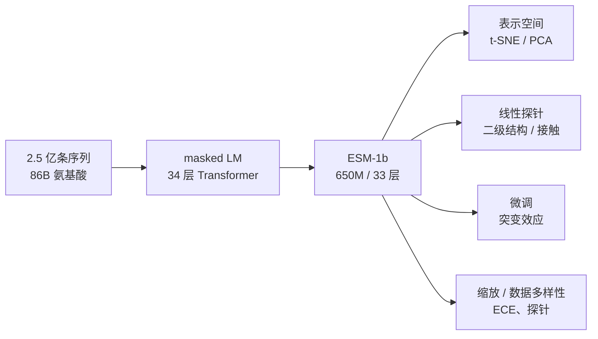

# 一段序列里，能读出多少生物学？——ESM-1 的主线、探针与边界

> **阅读范围**：bioRxiv 预印本（2020-12-15，46 页，含 SI）；正式版 PNAS 118(15):e2016239118（2021）。本笔记以预印本为主，数字与措辞以正式版为准。
> **这篇是什么**：ESM-1 的论文——用 2.5 亿条蛋白序列做 masked LM，证明**只靠序列自监督**，表示里就能长出从生化性质到二级结构、接触图、突变效应的多尺度组织。
> **同目录说明**：`ESM1.md` 是旧版详细笔记；本文按新版 x-ray 规范重写，主线是“表示里到底有什么、怎么证明”。
> **配图**：Fig. 2、4、5、7 从 PDF 300 dpi 裁切（`figs_esm1/`）。

---

## 0. 一页看懂（先读这一页）

### 0.1 三问

**① 这篇文章解决什么问题？**

在这之前，从序列推断结构/功能，主要靠 **MSA + 共进化**：把同源序列排起来，看哪些位点协同突变。但 MSA 有两个问题：每个蛋白都要单独搜索；同源序列少的蛋白，MSA 很浅。

ESM-1 问的是：

> **能不能用一个在 2.5 亿条序列上训练的语言模型，把“进化统计”压进参数，让一条序列本身就能给出结构和功能信息？**

**② 它怎么解决？**

一条链：

```
2.5 亿条 UniParc 序列
  → masked LM（Transformer；最终 33 层、650M 的 ESM-1b）
  → 每个残基/每条序列的表示
  → 线性探针（secondary structure / contact）
  → 微调（mutational effect）
  → 与未预训练、LSTM、HMM、CCMpred 比较
```

**③ 做了什么实验？**

| 实验                      | 对应主线的哪一环   | 关键数字                                                  |
| ----------------------- | ---------- | ----------------------------------------------------- |
| Fig. 2：表示空间的组织          | 表示里有没有生物学  | trained 的 ortholog 聚成簇；untrained/unigram 不聚           |
| Fig. 4 + Table 3/4：二级结构 | 结构信息是否线性可读 | ESM-1b 71.1%（family）/ 71.6%（CB513）/ 72.5%（CASP13）     |
| Fig. 5 + Table 3：接触图    | 三级结构是否线性可读 | ESM-1b Top-L 49.2%（family）/ 42.8%（fold）；CCMpred 32.6% |
| Fig. 7：突变效应             | 功能信息是否可迁移  | fine-tuned Transformer 在 12 个蛋白上 10 个超过 Envision      |
| Table 1/3：缩放与数据多样性      | 这些能力从哪来    | ECE 8.46（UR50/D）vs 10.32（UR100）；34 层比 6/12 层好         |

### 0.2 主线图



### 0.3 一句话结论

> **ESM-1 证明了“进化尺度的自监督”能把结构/功能信息压进表示，而且这些信息是线性可读的；它不是一个新的网络结构，而是一个经验命题 + 一套探针方法。**

---

## 1. 问题：把进化统计压进一个模型

传统路线是 **MSA → 共进化 → 接触/结构**。ESM-1 的赌注是：

> **如果给模型看足够多、足够多样的自然序列，masked LM 这个任务本身会逼它学到“哪些残基在进化上被允许、哪些位置在空间上相关”。**

这个想法不是 ESM-1 第一次提出，但 ESM-1 第一次把它做到 **2.5 亿条序列 / 6.5 亿参数**，并且系统性地用 **线性探针** 去测“表示里有什么”。

**注意：ESM-1 没有提出新架构，也没有提出新训练目标。** 它用的是 BERT 式 Transformer + masked LM；它的“概念”是一个经验命题：

> **多尺度生物组织（生化性质、同源性、二级/三级结构、突变效应）会出现在进化尺度语言模型的表示里，并且可以被线性读出。**

ESM-2 后来把这句命题推到原子级，并加了 ESMFold 读出；ESM-1 是那条线的起点。

---

## 2. 机制：ESM-1 怎么学

### 2.1 数据：2.5 亿条序列，三种多样性

- **UniParc（2019-01）**：约 **2.5 亿**条序列、**860 亿**个氨基酸；随机留 100 万条做验证。
- **UniRef50**：按 50% identity 聚类；随机留出 **10% 的 cluster** 做语言模型测试，属于这些 cluster 的序列全部从训练集删除——防止“背近重复序列”。
- 三种训练集，用来分离“数量”与“多样性”：
  - **UR100**：UniRef100 代表序列；数量大，但近重复多；
  - **UR50/S**：UniRef50 代表序列；多样性高，数量少；
  - **UR50/D**：在 UniRef50 cluster 之间均匀采样；多样性和密度都高。

**为什么这件事重要**：如果只按序列频率采样，模型会反复看少数大家族，学到的更多是“家族记忆”。UR50/D 的均匀采样是“逼它学规律”的关键设计。

### 2.2 模型：BERT 式 Transformer，650M 的 ESM-1b

- **34 层 Transformer**，约 **6.69 亿**参数，作为 scaling 基线；
- 超参数搜索后，放大到 **33 层、约 6.5 亿参数**，即 **ESM-1b**；训练在 UR50/S 上；
- **masked LM**：随机遮住 **15%** 的 token，让模型根据上下文猜；
- 输入是氨基酸字符序列；位置编码是可学习的（不是 ESM-2 的 RoPE）。

**关键点**：预训练时**没有任何结构标签、没有任何 MSA**。模型只看到单条序列和“被遮住的残基”。

### 2.3 读出：线性探针是“显微镜”

ESM-1 最重要的方法学设计，不是模型，而是**怎么测**：

- **二级结构**：在冻结的表示上拟合一个 **logistic regression**，做 8 类二级结构分类；
- **接触图**：对每一对位置 $(i,j)$，用两个线性投影得到向量，点积后做 logistic regression，预测“是否接触”；
- **为什么必须是线性**：如果线性探针就能读出结构，说明信息**已经线性地摆在表示里**，而不是被一个很强的下游网络“硬解”出来；
- **对照**：同一个探针，分别用在 **预训练前** 和 **预训练后** 的表示上——差值就是“预训练带来的信息”。

这是全篇的核心逻辑：**模型不变，只换表示；探针不变，只换训练与否。**

---

## 3. 实验：从生化性质到功能

### 3.1 表示空间的组织（Fig. 2）

![[figs_esm1/fig2_organization.png]]

> **承担什么**：证明预训练把“同源基因/生物学变异”组织进了表示空间，而不是只反映氨基酸组成。
> **先看这里**：上排 (a) 的 trained / untrained / unigram 三张 t-SNE；下排 (b) 的 PCA 方向。
> **想让你相信**：trained 表示里，同一 orthologous group 的基因聚在一起；untrained 和 unigram 不聚。
> **没画**：定量的同源检索 AUC（在 Table 2）；t-SNE 的失真；cluster 的统计显著性。

| 面板 | 画的是什么 | 轴 / 图例 | 能读出的数 | 读不出来 | 支撑的论点 |
|---|---|---|---|---|---|
| a | 序列表示的 t-SNE；每个点一个基因，颜色=orthologous group | 三张：trained / untrained / unigram | trained 的簇最紧；untrained/unigram 弥散 | cluster 的定量紧度；基因数 | 预训练组织了同源关系 |
| b | orthologous genes 的 PCA；a/b/c/d 是不同方向的变异 | 二维 PCA | trained 能把 a/b/c 方向分开；untrained/unigram 不能 | 每个方向的方差解释比例 | 生物学变异是线性方向 |

**这张图的边界**：t-SNE 是定性的；真正的定量证据是 Table 2 的 remote homology AUC 和 Table 3 的结构探针。**不要用 t-SNE 的“看起来聚得好”当唯一证据。**

### 3.2 二级结构：线性可读（Fig. 4 + Table 3/4）

![[figs_esm1/fig4_secondary.png]]

> **承担什么**：证明预训练后，冻结表示上的一条线性分类器就能恢复二级结构；预训练前不行。
> **先看这里**：每个 fold 的左右对比——左边 “With pre-training”，右边 “No pre-training”，以及下面的 8-class accuracy。
> **想让你相信**：结构信息不是下游网络硬解出来的；它在表示里，而且是线性可读的。
> **没画**：全部 test domain 的分布（Fig. S2）；8 类里哪些类容易错；只展示了两个 fold。

| 面板 | 画的是什么 | 能读出的数 | 读不出来 | 支撑的论点 |
|---|---|---|---|---|
| a | d1nt4a_（Phosphoglycerate mutase-like fold）的二级结构投影 | **70.6%** vs 36.6% | 逐类精度；其他 fold | 预训练带来结构 |
| b | d3wr7a_（Acyl-CoA N-acyltransferases fold） | **82.4%** vs 32.4% | 同上 | 同上 |

**Table 3 的定量结果**（五折交叉验证，按 family / superfamily / fold 划分）：

| 模型 | 预训练 | SSP（family / superfamily / fold） | Contact（family / superfamily / fold） |
|---|---|---|---|
| HMM profile | — | 47.9 / 47.8 / 48.0 | 14.8 / 14.5 / 14.6 |
| CCMpred | — | — | 32.7 / 32.5 / 32.6 |
| Transformer-34 | 无 | 41.5 / 41.3 / 41.3 | 8.7 / 8.4 / 8.4 |
| Transformer-34 | UR100 | 65.4 / 64.9 / 64.9 | 28.3 / 22.5 / 22.0 |
| Transformer-34 | UR50/S | 69.4 / 68.8 / 68.9 | 43.9 / 36.4 / 35.3 |
| **ESM-1b** | **UR50/S** | **71.1 / 70.5 / 70.6** | **49.2 / 43.5 / 42.8** |

**怎么读**：

- **无预训练 → 有预训练**：SSP 41.5 → 71.1；contact 8.7 → 49.2（family）。这是“结构信息是预训练带来的”最直接的证据。
- **数据多样性 > 数量**：UR100 65.4/28.3 vs UR50/S 69.4/43.9；接触图的提升尤其明显。
- **ESM-1b 超过 CCMpred**：42.8 vs 32.6（fold）；但这是**线性探针**，不是专门的接触预测器，不能当成 SOTA contact predictor。
- **Table 4**：在 CB513 / CASP13 上，ESM-1b 8 类精度 **71.6 / 72.5**，与 HMM profile 的 71.2 / 72.3 基本持平；说明线性探针已经能到“序列 profile”的水平。

### 3.3 接触图：长程接触也能线性读出（Fig. 5）

![[figs_esm1/fig5_contacts.png]]

> **承担什么**：证明接触图（三级结构）也能从冻结表示里线性读出，而且与 CCMpred 可比。
> **先看这里**：左图下半是 ESM-1b 的 Top-L 预测、上半是 CCMpred；蓝=真阳性，红=假阳性；右图是两者的 precision 散点。
> **想让你相信**：ESM-1b 不止能读二级结构，还能读长程接触。
> **没画**：全部 test domain 的逐点比较；接触定义（8 Å）；序列分离阈值（≥24）；只展示一个 fold-level 例子。

| 面板 | 画的是什么 | 轴 / 图例 | 能读出的数 | 读不出来 | 支撑的论点 |
|---|---|---|---|---|---|
| 左 | d1n3ya_ 的接触图；ESM-1b 在下三角，CCMpred 在上三角 | 蓝=TP，红=FP，灰=真实接触 | 视觉上两者都能抓到主要接触 | 逐点精度；长程比例 | 接触可线性读出 |
| 右 | Top-L 长程 precision：ESM-1b vs CCMpred | x=CCMpred，y=ESM-1b | 多数点在对角线以上 | 样本量；异常点 | ESM-1b 更高 |

**Table 3 的接触数字**：ESM-1b 49.2 / 43.5 / 42.8（family / superfamily / fold），CCMpred 32.7 / 32.5 / 32.6。**但**：这是线性探针，不是端到端接触预测；论文的 claim 是“表示里含接触信息”，不是“我们做出了最好的接触预测器”。

### 3.4 突变效应：表示可以迁移到功能（Fig. 7）

![[figs_esm1/fig7_mutations.png]]

> **承担什么**：证明表示不只含结构，还能通过微调迁移到“突变效应”这种功能任务。
> **先看这里**：蓝=Transformer，橙=LSTM，红/绿=已发表方法；每个蛋白的 Spearman ρ。
> **想让你相信**：fine-tuned Transformer 在多数蛋白上超过 Envision，也超过 LSTM。
> **没画**：zero-shot 突变预测；ESM-1v；不同训练比例（Fig. S5）；误差来源。

| 面板 | 画的是什么 | 轴 / 图例 | 能读出的数 | 读不出来 | 支撑的论点 |
|---|---|---|---|---|---|
| Envision | 12 个蛋白的突变效应；Transformer vs Gray 2018 | y=Spearman ρ | **10/12** 超过 Envision | 每个蛋白的置信区间 | 微调后可迁移 |
| DeepSequence | >100 个 deep mutational scanning 数据集 | y=Spearman ρ | Transformer 超过 LSTM baseline | 与无监督 DeepSequence 不直接可比 | 表示含功能信息 |

**规模**：>700,000 个突变测量、>100 个实验数据集；在 Envision 的 12 个蛋白上 10 个超过；留一蛋白泛化在 9 个任务里 5 个超过 Envision。

**重要边界**：这是 **fine-tuned** 结果，不是 zero-shot。ESM-1v 才是专门做 zero-shot 突变效应的工作；不要把这篇文章的突变结果说成“零样本”。

---

## 4. 缩放与数据多样性：这些能力从哪来

**Table 1 的 ECE**（exponentiated cross-entropy；随机模型约 25，完美模型 1；越低越好）：

| 模型 | 数据 | ECE |
|---|---|---:|
| Uniform random | — | 25 |
| 4-gram | UR50/S | 17.18 |
| LSTM（large, 113.4M） | UR50/S | 13.54 |
| Transformer 6 层（42.6M） | UR50/S | 11.79 |
| Transformer 12 层（85.1M） | UR50/S | 10.45 |
| Transformer 34 层（669.2M） | UR100 | 10.32 |
| Transformer 34 层 | UR50/S | 8.54 |
| Transformer 34 层 | UR50/D | **8.46** |
| Transformer 34 层（10% 数据） | UR50/S | 10.99 |
| Transformer 34 层（1% 数据） | UR50/S | 15.01 |
| Transformer 34 层（0.1% 数据） | UR50/S | 17.50 |

**三个结论**：

1. **模型容量有用**：6 → 12 → 34 层，ECE 11.79 → 10.45 → 8.54；SSP 62.4 → 65.5 → 69.4；contact 24.4 → 32.8 → 43.9（Table 3）。
2. **数据多样性有用**：UR100 10.32 vs UR50/S 8.54 vs UR50/D 8.46；contact 28.3 → 43.9。
3. **数据量有用**：10% → 1% → 0.1%，ECE 10.99 → 15.01 → 17.50。

**这三个因素是分开的**：不是“模型越大越好”，也不是“数据越多越好”；ESM-1 的贡献之一是把“容量、数量、多样性”拆开做对照。

---

## 5. 承重判定：拆掉哪个会塌

| 设计 | 判定 | 证据 | 白话：拔掉会怎样 |
|---|---|---|---|
| **masked LM 目标** | **承重** | 无预训练 41.5 SSP / 8.7 contact vs ESM-1b 71.1 / 49.2 | 没有它，表示里没有结构信息 |
| **进化尺度数据（250M/86B）** | **承重** | 0.1% 数据 ECE 17.50；10% 10.99 | 数据少，表示学不到通用约束 |
| **数据多样性（UR50）** | **承重** | UR100 contact 28.3 vs UR50 43.9 | 只堆近重复序列，学的是家族记忆 |
| **模型容量（6/12/34 层；ESM-1b 33 层/650M）** | **承重** | 6/12/34 层：contact 24.4/32.8/43.9 | 小模型读不出长程接触 |
| **线性探针** | 诊断（不是模型） | 线性可读；预训练前后对照 | 拔掉它，无法证明信息在表示里 |
| **微调** | 贡献（对功能） | 突变效应 10/12 | 拔掉它，只能做结构探针，不能做功能迁移 |
| **具体层数/头数/学习率** | 装饰 | 超参数搜索，未逐一消融 | 换一组可能仍工作，但影响 ECE |

**一句话**：撑住 ESM-1 的是“**masked LM + 进化尺度的多样性 + 足够容量**”；线性探针是显微镜，不是地基。

---

## 6. 公式与指标：三个可手算的量

### 6.1 Masked LM 损失

$$\mathcal{L}_{\text{MLM}}=\mathbb{E}_{x}\left[-\sum_{i\in M}\log p_\theta(x_i\mid x_{\setminus M})\right]$$

遮住 15% 的 token，让模型根据上下文猜；猜得准，说明它学到了序列约束。

### 6.2 ECE（exponentiated cross-entropy）

$$\text{ECE}=\exp\left(-\frac{1}{N}\sum_{i=1}^{N}\log p_\theta(x_i)\right)$$

直观理解：模型在每个位置平均在多少个氨基酸里犹豫。随机模型约 25，完美模型 1；8.46 约等于“每个位置在 8–9 个候选里选”。

### 6.3 Top-L 长程接触精度

对长度 $L$ 的蛋白，取模型打分最高的 $L$ 个接触对，只保留序列分离 ≥24 的“长程”对，算其中真实接触（8 Å 内）的比例：

$$\text{Precision@L}=\frac{\#\{\text{top-}L\text{ 长程预测中，真实距离}<8\text{ Å}\}}{L}$$

**手算**：L=100，top-100 长程预测里 43 个是真的 → 0.43。ESM-1b 在 fold-level 是 0.428，CCMpred 是 0.326。

---

## 7. 证据边界

### 站得住的

1. **结构信息确实是预训练带来的**：同一线性探针，预训练前 41.5 SSP / 8.7 contact，预训练后 71.1 / 49.2。
2. **二级结构线性可读**：CB513 71.6、CASP13 72.5，与 HMM profile 基本持平。
3. **接触图线性可读**：fold-level 42.8，高于 CCMpred 的 32.6。
4. **表示能迁移到功能**：fine-tuned 突变效应在 12 个蛋白里 10 个超过 Envision。
5. **缩放/多样性/数量都被拆开验证**：6/12/34 层、UR100/UR50、10%/1%/0.1% 数据。

### 没建立 / 被夸大的

1. **线性可读 ≠ 全部信息**：线性探针只能证明“线性可读”；非线性探针可能读出更多，也可能读出更少。没有线性信号不等于没有信息。
2. **t-SNE 是定性的**：Fig. 2 的簇看起来好，不等于定量同源检索一定好；定量在 Table 2/3。
3. **接触探针不是 SOTA 接触预测器**：它和 CCMpred/HMM 比，不是和深度接触预测器比；“表示里有接触信息”≠“最好的接触预测”。
4. **突变效应是 fine-tuned，不是 zero-shot**：ESM-1v 才是 zero-shot；这篇的 10/12 是监督微调后的结果。
5. **“功能涌现”是间接证据**：只测了突变效应，没有测 binding、稳定性、表达等更广的功能。
6. **预印本 vs PNAS**：这份 PDF 是 2020-12 预印本，数字/措辞以 2021 PNAS 正式版为准；SI 里还有更多消融。
7. **结构测试的泄漏风险**：SCOPe 按 family/superfamily/fold 划分，但预训练序列可能含同源物；作者用 UniRef50 cluster 留出降低风险，但不能完全排除。
8. **650M/33 层不是终点**：ESM-2 后来用 8M 就追平 ESM-1b 的接触精度；说明架构/数据/训练目标的改进，和单纯“更大”同样重要。

**一句话**：它证明了“**结构/功能信息可以在进化尺度自监督中涌现，并且线性可读**”；它没有证明“线性探针能读出所有信息”，也没有证明“这就是最好的结构/功能预测器”。

---

## 8. 读完带走的五句话

1. **ESM-1 的主线是“测表示里有什么”，不是“造一个更好的结构预测器”**：线性探针是显微镜，不是产品。
2. **预训练前后对照是最强的证据**：同一探针，41.5 → 71.1 SSP、8.7 → 49.2 contact；这比任何 t-SNE 都硬。
3. **数据多样性比单纯数量更重要**：UR100 → UR50，contact 28.3 → 43.9；这是“进化尺度”真正的含义。
4. **结构、功能、同源性都在同一个表示里**：二级结构、接触、突变效应、remote homology，用的是同一套表示。
5. **ESM-1 是 ESM-2 的“假设证明”**：ESM-2 把规模推到 15B，并加 ESMFold 读出原子坐标；ESM-1b 是那条线的基线。

## 还开着的问题

- **表示里到底编码了什么？** 线性探针只给“可读”，不给“机制”。
- **非线性探针能读出更多吗？** 论文只做线性；这是一个明确的空白。
- **zero-shot 突变效应呢？** ESM-1v 是后续工作；这篇是 fine-tuned。
- **数据和模型哪个更关键？** 论文拆开了多样性和数量，但没有给出“下一步该加哪个”的定量配方。
- **650M 是极限吗？** ESM-2 用 8M 追平 ESM-1b 的接触精度，说明“更大”不是唯一方向。

---

## 附：图表索引

| 文件 | 原文位置 | 内容 | 本文解码处 |
|---|---|---|---|
| `figs_esm1/fig2_organization.png` | Fig. 2（第 5 页） | 序列表示的 t-SNE / PCA | §3.1 |
| `figs_esm1/fig4_secondary.png` | Fig. 4（第 8 页） | 二级结构线性投影的两个 fold 例子 | §3.2 |
| `figs_esm1/fig5_contacts.png` | Fig. 5（第 8 页） | 接触图与 CCMpred 对比 | §3.3 |
| `figs_esm1/fig7_mutations.png` | Fig. 7（第 12 页） | 突变效应的 fine-tuned 结果 | §3.4 |

## 附：术语速查（忘了再查）

> 不是要求先读的表，只是索引。正文里每个词第一次出现时都有解释。

| 术语 | 一句话 | 解释位置 |
|---|---|---|
| masked LM | 遮住残基让模型猜 | §2.2 |
| ECE | 指数化交叉熵，越低越好；随机约 25 | §2.2、§6.2 |
| 线性探针 | 冻结表示上只训练一个线性分类器 | §2.3 |
| 8 类二级结构 | 8 种 DSSP 二级结构标签 | §3.2 |
| Top-L 长程接触 | 取 top-L 预测，只算序列分离 ≥24 的接触 | §3.3、§6.3 |
| 突变效应 | 突变对蛋白功能的定量影响（如 DMS 数据） | §3.4 |
| UR100 / UR50/S / UR50/D | 三种不同多样性的训练集 | §2.1 |
| ESM-1b | 650M / 33 层的最终模型 | §2.2 |
