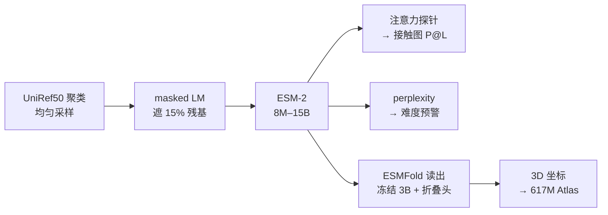

# 一条序列里，语言模型到底学了多少结构？——ESM-2 的主线、探测与边界

> **阅读范围**：bioRxiv 预印本（28 页，含 Materials and Methods；正式版 Science 379, 1123–1130, 2023）。本笔记以预印本为主，方法细节比 8 页正式版多。
> **这篇是什么**：ESM-2 的论文——把蛋白语言模型从 8M 扩到 15B，证明"结构信息在表示里随规模涌现"，并用 ESMFold 把表示读成 3D、用 Atlas 把它用到 6 亿条序列。
> **同目录说明**：`ESM2.md` 是旧版详细笔记；本文按新版 x-ray 规范重写，主线是"语言模型学到了什么"，不是"怎么生成 3D"（3D 生成见 ESMFold 篇）。
> **配图**：Fig. 1A、1B/C、2B、3A 从 PDF 300 dpi 裁切（`figs_esm2/`）。

---

## 0. 一页看懂（先读这一页）

### 0.1 三问

**① 这篇文章解决什么问题？**

蛋白语言模型（PLM）早就能从序列里学到**低分辨率**的结构信息——二级结构、接触图 roughly。但"低分辨率"离"原子级结构"还很远。与此同时，AlphaFold2 的强依赖 **MSA**：没有同源序列，精度就掉。于是问题变成：

> **一个只读序列的语言模型，随规模扩到 15B，能不能把原子级结构学进参数？如果能，它能不能替代 MSA？**

**② 它怎么解决？**

一条链：

```
UniRef50 聚类 → masked LM 预训练 → ESM-2（8M–15B）
   ├─ 注意力探针 → 接触图（P@L）
   ├─ perplexity → 难度/质量预警
   └─ ESMFold 读出（冻结 3B + 折叠头）→ 3D 坐标 → 宏基因组 Atlas
```

- **学**：在 UniRef50 上做 masked language modeling——遮住残基，让模型猜。要猜准，模型必须学到"哪些残基在进化上被允许、哪些位置在空间上挨着"。
- **探**：把注意力头线性投影成接触图，用 P@L（长程接触精度）测"表示里有没有结构"。
- **读**：把 3B ESM-2 冻住，接一个 folding head（ESMFold），把表示读成原子坐标。
- **用**：用 ESMFold 批量折叠 MGnify90，构建 6.17 亿条的 Atlas。

**③ 做了什么实验？**

| 实验 | 对应主线的哪一环 | 关键数字 |
|---|---|---|
| Fig. 1B/C：接触精度随规模/同源深度 | 学：表示里有没有结构 | 8M→15B；150M ESM-2 ≈ 650M ESM-1b |
| perplexity（Fig. S1 / 正文） | 学：模型对序列的"理解度" | 8M 10.45 → 15B 6.37 |
| Fig. 2B：ESMFold 的 3D 精度 | 读：表示能不能变成坐标 | CAMEO 0.83；CASP14 0.68；无 MSA 的 AF2 0.41/0.38 |
| Fig. 3A：Atlas 与 AF2 的一致性 | 用：能不能 scale | 617M 条，225M 高置信；LDDT 相关 0.79 |

### 0.2 主线图



### 0.3 一句话结论

> **ESM-2 证明了"结构可以被压进序列表示"，并且这个表示随规模变得更精确；但它不是免费的——15B 的收益主要在接触/低同源蛋白，3D 读出仍要一个监督训练的折叠头（ESMFold），而 ESMFold 用的是 3B，不是 15B。**

---

## 1. 问题：从"低分辨率结构"到"原子级结构"

PLM 不是新东西：ESM-1b 已经能从序列表示里学到二级结构和粗略的接触。真正的问题是**分辨率**：

- 接触图只告诉你"谁和谁近"，不告诉你"在哪个方向、多远"；
- 要从接触走到原子坐标，需要几何求解；
- 而 AF2 的几何求解，靠的是 MSA 提供的共进化。

这篇论文的赌注是：

> **masked LM 在进化尺度的序列上训练到足够大，会把"共进化 → 结构"的规律压进参数；规模越大，表示越接近原子级。**

**注意：它没有提出一个"命名的概念"。** 它的概念是一个**经验命题**：

> **原子级结构信息在蛋白语言模型的表示里，随规模涌现；因此 MSA 可以被这个表示替代（至少部分替代）。**

ESM-2 是"学"的部分，ESMFold 是"读"的部分，Atlas 是"用"的部分。三者不能混为一谈。

---

## 2. 机制：ESM-2 怎么把结构学进参数

### 2.1 训练目标：masked language modeling

对一条序列 $x=(x_1,\dots,x_L)$，随机遮住约 **15%** 的残基（集合 $M$），让模型根据上下文猜：

$$\mathcal{L}_{\text{MLM}}=\mathbb{E}_{x}\left[-\sum_{i\in M}\log p_\theta(x_i\mid x_{\setminus M})\right]$$

这个目标只要求"猜残基"，不要求"预测结构"。但要在这条高度受约束的序列上猜得准，模型必须学到：

- 局部基序（motif）；
- 远距离残基依赖；
- 进化约束（哪些突变被允许）；
- 以及这些约束背后的空间关系。

**这就是"结构涌现"的来源**：结构不是被显式监督的，而是"猜残基"这个任务的副产物。

### 2.2 数据：UniRef50 聚类 + 均匀采样

- 训练集：**UniRef50（2021-09 版）**，约 **4,300 万**个聚类；
- **不是按序列频率采样**，而是先均匀抽聚类，再从聚类里抽一条 UniRef90 成员——避免大同源家族支配训练分布；
- 实际训练见过 **>6,000 万**条不同序列（正式版写约 6,500 万）；
- 去掉了 de novo 设计蛋白（避免"背答案"）；
- 验证集随机留 0.5%，并用 MMseqs 去掉与验证集 50% 以上同源的训练序列。

**为什么这一步重要**：如果按频率采样，模型会反复看少数大家族，学到的更多是"家族记忆"而不是"通用结构约束"。均匀采样是"逼它学规律"的关键设计。

### 2.3 架构：BERT-style encoder + RoPE

- **BERT 风格 encoder-only Transformer**；随规模调整层数、注意力头数、hidden size、FFN size（具体在 Table S1）；
- **RoPE（旋转位置编码）**：让模型能外推到训练窗口之外；论文观察它对小模型提升明显，模型变大后收益变小；
- **去掉 dropout**：把容量让给参数；
- 训练：随机裁到 **1024 token**，加 BOS/EOS 区分"完整蛋白"和"被裁的片段"；batch 2M token（15B 用 3.2M）；500K updates（15B 用 270K）；Adam，lr 4e-4（15B 1.6e-4）。

**为什么是 encoder-only**：ESM-2 不需要生成序列，只需要"理解"序列——每个位置的上下文表示。masked LM 正好是 encoder 的训练方式。

### 2.4 探测：从注意力到接触图

这是全篇最关键的"测量"设计：**不训练任何结构预测头**，直接把注意力头线性投影成接触图：

- 对每一对残基 (i,j)，取注意力权重，线性组合成一个"接触概率"；
- 取 top-L 个预测接触，算长程接触精度 **P@L**；
- 与真实结构（8 Å 以内算接触）对比。

这一步的意义：**它测的是"表示里有没有结构"，而不是"结构头有多强"。** 如果 P@L 随规模上升，说明结构信息确实在 ESM-2 的表示里，而不是被某个监督头"硬塞"进去的。

![[figs_esm2/fig1a_contact.png]]

> **承担什么**：证明 ESM-2 的注意力里已经含有"哪些残基在空间上挨着"的信息——这是"结构涌现"的第一个直接证据。
> **先看这里**：左侧绿色卡通是 3LYW 的结构；右侧矩阵是模型自己学出来的接触图；蓝点=真阳性，红点=假阳性，灰点=其他接触。
> **没画**：这只是 3LYW 一个蛋白；它不能证明所有蛋白都这样；也没有给出"接触概率"的绝对值。

| 面板 | 画的是什么 | 轴 / 图例 | 能读出的数 | 读不出来 | 支撑的论点 |
|---|---|---|---|---|---|
| A | 3LYW 的注意力接触图 vs 真实接触 | 蓝=真阳性，红=假阳性，灰=其他接触；虚线=对角线 | 注意力已经像接触图；假阳性很少 | 其他蛋白是否一样；接触概率绝对值 | 序列表示里含空间邻近信息 |

### 2.5 读出：ESMFold 把表示变成 3D

ESM-2 只输出表示，不输出坐标。要把表示变成原子结构，需要 **ESMFold**：

- 冻结 **3B 参数**的 ESM-2；
- 接 **48 个 folding trunk block**（seq↔pair 交替更新）+ **8 个 structure module block**（IPA 预测主链帧）+ **3 次 recycling**；
- 训练用约 25,450 个聚类、325,498 条 PDB 链，外加约 1,348 万条 AF2 预测结构做蒸馏；
- 输出全原子坐标 + pLDDT / pTM。

**关键区分**：ESM-2 是**自监督**的；ESMFold 是**有监督**的（用 PDB 结构训练）。所以"ESM-2 学到了结构"和"ESMFold 能预测结构"是两件事——后者依赖前者，但前者不依赖后者。

> 3D 生成的六步走读（读序列 → 建 pair 表 → trunk → structure module → recycling → 输出）见 [ESMFold 篇](../ESMFOLD/ESMFold_Science2023_xray.md)，这里不重复。

### 2.6 应用：ESM Metagenomic Atlas

用 ESMFold 折叠 MGnify90：

- **617M** 条序列；
- **225M** 条高置信（pLDDT > 0.7 且 pTM > 0.7），约 **36.5%**；
- 2 周、**2,000 张 GPU**；
- 高置信里 **76.8%** 与 UniRef90 的 identity < 90%；**12.6%** 在 PDB 里没有实验结构匹配。

Atlas 是"用"的部分：它证明这套表示 + 读出 + 速度，能把结构预测变成数据库级别的操作。

---

## 3. 实验：scaling 到底带来了什么

### 3.1 接触精度随规模上升（Fig. 1B/C）

![[figs_esm2/fig1bc_scaling.png]]

> **承担什么**：证明"结构信息"不是某个固定模型里偶然出现的，而是随规模持续变强。
> **先看这里**：B 的曲线整体随参数量上移；C 里同源命中数越少（红/橙线）的组，随规模上升越陡。
> **想让你相信**：规模不是噱头；它真的在把结构学进表示。
> **没画**：接触精度不等于 3D 精度；这里没有 TM-score。

| 面板 | 画的是什么 | 轴 / 图例 | 能读出的数 | 读不出来 | 支撑的论点 |
|---|---|---|---|---|---|
| B | 长程接触精度 P@L，按同源命中数分组 | x=MMseqs hits；y=P@L；颜色=ESM-2 规模 | 规模越大越好；150M ESM-2 ≈ 650M ESM-1b | 每组蛋白数；误差线 | 规模提升接触精度 |
| C | 同上的另一种切法：按规模 | x=参数量；y=P@L；线=不同同源深度 | 同源越深，饱和越早；低同源组持续上升 | 低同源组的失败率 | 低同源蛋白更依赖规模 |

**两个关键事实**：

1. **150M ESM-2 已经接近 650M ESM-1b**：架构/数据的改进，让小模型追上了上一代大模型。
2. **低同源蛋白的收益更大**：同源序列越少，规模带来的提升越陡——这正是"语言模型替代 MSA"最有价值的地方。

**perplexity 的两个锚点**：8M 模型在 held-out UniRef50 上 **10.45**，15B **6.37**。模型越大，对序列越"不惊讶"。

**perplexity 和接触精度的关系**：论文用 NDCG 衡量"Δperplexity 排序"与"Δcontact 排序"的一致性，平均 **0.87**。也就是说，**perplexity 降得多的蛋白，接触精度通常也提升得多**——这为后面"用 perplexity 预警"埋下伏笔。

### 3.2 不同蛋白的"门槛规模"不同

论文举了两个例子：

- **7QQA**：在 **150M** 参数后，预测精度明显变好；
- **T1056**：要到 **15B** 才明显变好。

**含义**：不存在一个"所有蛋白都够用"的规模；难蛋白需要更大的模型。这也是为什么论文既要 3B（ESMFold 的默认），又要 15B（scaling 的上限）。

### 3.3 读出成 3D：ESMFold 的精度（Fig. 2B）

![[figs_esm2/fig2b_accuracy.png]]

> **承担什么**：证明"表示里学到的结构"可以被读成真实坐标，而不是只停留在接触图。
> **先看这里**：Standard 组 ESMFold vs AF2 vs RoseTTAFold；No MSA 组 AF2/RF 掉到 0.4 左右。
> **想让你相信**：单序列 3D 预测是可行的，不是"玩具"。
> **没画**：CASP14 的 −0.17 差距为什么这么大；perplexity 的解释在正文。

| 组 | 数据集 | ESMFold | AF2（标准） | RoseTTAFold | AF2（无 MSA） | RF（无 MSA） |
|---|---|---|---|---|---|---|
| CAMEO | 194 个 | **0.83** | 0.88 | 0.82 | 0.41 | 0.47 |
| CASP14 | 51 个 | **0.68** | 0.85 | 0.81 | 0.38 | 0.37 |

**怎么读**：

- 平均低于 AF2：CAMEO −0.05，CASP14 **−0.17**；
- 但远高于"无 MSA 的 AF2"：0.83 vs 0.41，0.68 vs 0.38——ESM-2 补上了 MSA 的大部分信息；
- "匹配一半以上蛋白"是 **LDDT <0.05** 的口径，不是 TM-score 或原子级精度。

### 3.4 规模到 6 亿：Atlas 与 AF2 的一致性（Fig. 3A）

![[figs_esm2/fig3a_atlas.png]]

> **承担什么**：证明 ESMFold 与 AF2 在宏基因组规模上大体一致，因此"高置信"可以当大规模筛选依据。
> **先看这里**：散点沿对角线；Pearson 0.79；左下角低 LDDT 的尾部。
> **想让你相信**：6 亿条预测不是瞎猜，至少与 AF2 同向。
> **没画**：实验验证；高置信但错误的比例。

| 面板 | 画的是什么 | 轴 / 图例 | 能读出的数 | 读不出来 | 支撑的论点 |
|---|---|---|---|---|---|
| A | ESMFold 与 AF2 的 LDDT 对比（子样本） | x=ESMFold LDDT；y=AF2 LDDT；颜色=密度 | Pearson **0.79** | 尾部误差；分布外 | 与 AF2 大体一致 |

**Atlas 的数字**：617M / 225M 高置信；2 周 / 2000 GPU；76.8% 远离 UniRef90；12.6% 无 PDB 匹配。

---

## 4. 代价与边界：15B 不是免费的

### 4.1 平均仍低于 AF2

| 测试集 | ESMFold | AF2 | 差距 |
|---|---:|---:|---:|
| CAMEO（194） | 0.83 | 0.88 | −0.05 |
| CASP14（51） | 0.68 | 0.85 | **−0.17** |

- 高置信子集（pLDDT > 0.7）能追到 0.83 vs 0.85（LDDT）；
- 但 CASP14 的 −0.17 说明：**难目标上，MSA 仍然有用**。

### 4.2 15B 不是 ESMFold 的默认

- ESMFold 用的是 **3B** ESM-2；
- 15B 只在 scaling 分析里出现（接触预测、structure-module-only 头）；
- 15B 的训练/推理成本高一个数量级；收益主要在低同源、难蛋白。

### 4.3 "结构涌现"的证据强度

- **接触图是低分辨率**：它只说明"谁和谁近"，不说明"在哪个方向、多远"；
- **注意力探针是线性投影**：它测的是"表示里有没有结构"，不是"模型能不能直接输出结构"；
- **ESMFold 是有监督的**：3D 精度依赖 PDB 训练，不是纯自监督；
- **perplexity 相关不等于因果**：低 perplexity 可能只是"训练集里见过同源物"。

### 4.4 Atlas 的"高置信"是模型自评

- pLDDT/pTM > 0.7 不等于实验验证；
- 225M 条里有多少真错，未知；
- 与 AF2 的一致性（0.79）只能说明"两个模型同向"，不能说明"两个都对"。

---

## 5. 承重判定：拆掉哪个会塌

| 设计 | 判定 | 证据 | 白话：拔掉会怎样 |
|---|---|---|---|
| **Masked LM 目标** | **承重** | 唯一监督信号；没有它就没有表示 | 方法不存在 |
| **规模（8M→15B）** | **承重** | 接触 P@L 随规模上升；15B 才解决 T1056 | 小模型在难蛋白上不够 |
| **UniRef50 聚类均匀采样** | **承重** | 避免大 家族支配；训练见过 >60M 序列 | 退化成"家族记忆" |
| **RoPE** | 贡献（非核心） | 小模型提升明显；大模型收益变小 | 拔掉小掉，长序列外推变差 |
| **注意力探针** | 诊断（不是模型） | P@L；NDCG 0.87 | 拔掉不影响模型，但无法证明"结构在表示里" |
| **ESMFold 读出** | **承重（对 3D）** | CAMEO 0.83 / CASP14 0.68 | 没有它，ESM-2 只有表示，没有坐标 |
| **Atlas** | 展示（规模证明） | 617M / 225M | 拔掉不影响方法，但影响"演化尺度"的主张 |

**一句话**：撑住 ESM-2 的是"**masked LM + 规模 + 数据采样**"；ESMFold 是把表示变成 3D 的读出器，Atlas 是规模演示。

---

## 6. 公式与指标：三个可手算的量

### 6.1 MLM 损失

$$\mathcal{L}_{\text{MLM}}=\mathbb{E}_{x}\left[-\sum_{i\in M}\log p_\theta(x_i\mid x_{\setminus M})\right]$$

### 6.2 Perplexity

$$\text{PPL}(x)=\exp\left(-\frac{1}{N}\sum_{i=1}^{N}\log p_\theta(x_i\mid x_{<i})\right)$$

直观理解：模型在每个位置平均在多少个氨基酸里犹豫。随机模型约 20；8M 模型 10.45；15B 模型 6.37。

**手算**：perplexity 6.4 ≈ 每个位置在 6–7 个候选里选；10.5 ≈ 10–11 个。候选越少，说明模型对序列约束越确定。

### 6.3 接触精度 P@L

对长度 L 的蛋白，取模型预测的 top-L 个接触，算其中有多少是真的：

$$\text{P@L}=\frac{\#\{\text{预测的 top-L 接触中，真实距离}<8\text{ Å}\}}{L}$$

**手算**：L=100，top-100 预测里 60 个是真的 → P@L=0.60。P@L 越高，说明注意力里的接触越准。

---

## 7. 证据边界

### 站得住的

1. **结构信息确实在表示里**：接触 P@L 随规模上升；150M ESM-2 ≈ 650M ESM-1b；注意力图与真实接触对得上。
2. **规模带来持续收益**：尤其低同源蛋白；15B 解决 150M 解决不了的 T1056。
3. **表示可以被读成 3D**：ESMFold CAMEO 0.83 / CASP14 0.68，远超无 MSA 的 AF2（0.41/0.38）。
4. **速度使规模应用成为可能**：14.2 秒/384 残基，6×；短序列 60×；617M Atlas。
5. **perplexity 是有效的预警器**：与接触精度变化 NDCG 0.87；与 3D 精度相关。

### 没建立 / 被夸大的

1. **平均仍低于 AF2**：CAMEO −0.05，CASP14 −0.17；"匹配一半以上"是 LDDT 口径。
2. **接触 ≠ 3D**：接触图只给"谁和谁近"，不给方向和距离；3D 仍需 ESMFold 的监督训练。
3. **15B 不是默认**：ESMFold 用 3B；15B 的收益主要在难蛋白，成本高一个数量级。
4. **perplexity 相关不是因果**：低 perplexity 可能只是"训练集见过同源物"；存在数据泄漏/乐观偏差的可能。
5. **测试集小**：CAMEO 194、CASP14 51；18 个低 perplexity 的 CASP14 子集是事后选的。
6. **Atlas 的"高置信"是模型自评**：没有湿实验；与 AF2 一致不等于正确。
7. **预印本 vs 正式版**：本笔记以预印本为主；正式版可能改了措辞/数字，引用时以正式版为准。
8. **单序列 AF2 对比是人为设定**：AF2 没为单序列训练；这个对比说明"ESMFold 在单序列场景更好"，不说明"整体更好"。

**一句话**：它证明了"**结构可以被压进序列表示，并随规模变精确**"；它没有证明"语言模型已经全面替代 MSA"，也没有证明"6 亿条高置信结构都是真的"。

---

## 8. 读完带走的五句话

1. **ESM-2 的主线是"学"，不是"读"**：masked LM + 规模 + 数据采样，把结构压进表示；ESMFold 只是读出器。
2. **接触图是"表示里有没有结构"的探针**：它不训练结构头，因此比"结构头刷分"更能说明问题。
3. **规模解决的是"低同源"**：同源越少，规模收益越大；这正是语言模型相对 MSA 的价值。
4. **15B 不是默认**：ESMFold 用 3B；15B 是 scaling 的上限，成本高、收益集中在难蛋白。
5. **perplexity 是预警器**：它把"这条序列我有没有把握"变成可计算的量；高 perplexity 就是盲区。

## 还开着的问题

- **结构到底存在哪一层？** 注意力头、残差流、还是 FFN？论文只给了接触图级别的证据。
- **15B 的收益值不值？** 3B 已经能到 0.83/0.68；15B 主要解决少数难蛋白。
- **perplexity 能否跨分布预测？** 宏基因组蛋白的校准没有实验验证。
- **能不能不要 ESMFold 的监督？** 纯自监督表示 + 轻量几何求解，能否到原子级？
- **Atlas 里有多少是真的？** 需要湿实验抽样，而不是与 AF2 对比。

---

## 附：图表索引

| 文件 | 原文位置 | 内容 | 本文解码处 |
|---|---|---|---|
| `figs_esm2/fig1a_contact.png` | Fig. 1A | 注意力接触图 | §2.4 |
| `figs_esm2/fig1bc_scaling.png` | Fig. 1B/C | 接触精度随规模/同源深度 | §3.1 |
| `figs_esm2/fig2b_accuracy.png` | Fig. 2B | ESMFold 的 CAMEO/CASP14 精度 | §3.3 |
| `figs_esm2/fig3a_atlas.png` | Fig. 3A | Atlas 与 AF2 的 LDDT 一致性 | §3.4 |

## 附：术语速查（忘了再查）

> 不是要求先读的表，只是索引。正文里每个词第一次出现时都有解释。

| 术语 | 一句话 | 解释位置 |
|---|---|---|
| PLM | 把蛋白序列当文本训练的 Transformer | §1 |
| masked LM | 遮住残基让模型猜 | §2.1 |
| perplexity | 模型对序列的"惊讶程度"，越低越好 | §2.1、§6.2 |
| P@L | top-L 接触里真接触的比例 | §2.4、§6.3 |
| 接触图 | 残基两两是否在 8 Å 内 | §2.4 |
| ESMFold | 冻结 ESM-2 + 折叠头，输出 3D 坐标 | §2.5 |
| pLDDT / pTM | 逐残基 / 整体置信度 | §2.5 |
| 宏基因组 Atlas | 6.17 亿条环境微生物序列的预测结构库 | §2.6 |
