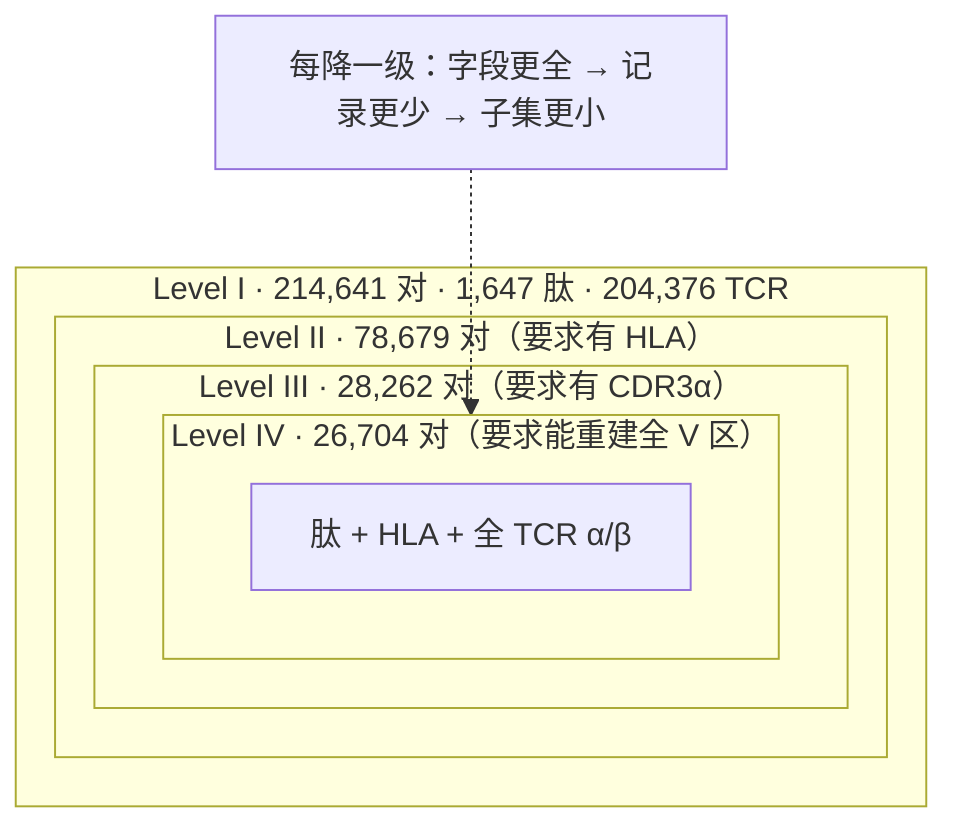
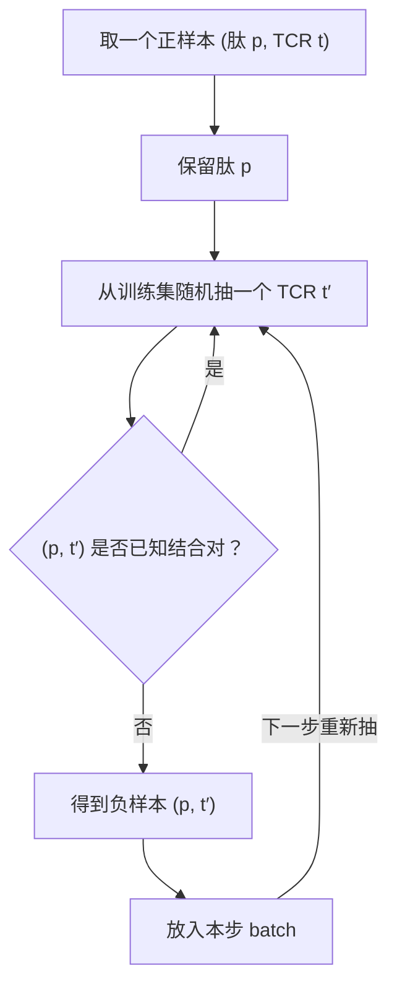

# Hi-TPH 精读：这个领域过去几年刷的可能不是"结合"，是"负样本"

> **阅读范围**：正刊 12 页（Introduction / Results / Discussion / Methods / Data & Code availability），Table 1、Table 2，Fig. 1–4 的图注与全部面板。
> **未读**：Supplementary Information（Tables 1–17、Figs. 1–10、Algorithm 1）。本地只有正刊 PDF。凡是依赖 SI 的结论，一律标注「作者声称，SI 未读」，不替它背书。
> **本文中的计算**：第 5 节的样本量分解、第 6 节的负空间覆盖、第 8 节的百分比复算、第 10 节的逐层增益，都是用 Table 1 / Table 2 / Fig. 4 的原始数字自己算的，已标出处；**它们不是论文里的数字**。
> **配图**：四张原图 + Table 1 原表，都是原文裁切（300 dpi，`figs/`），未重绘。每张图/表都配了「图的合同 + 逐面板/逐列解读 + 它没画什么」，这是这份稿子和摘要式解读最大的区别。
> **读法**：如果只读两节，读 **第 2 节（Fig. 1 逐面板）** 和 **第 8 节（Fig. 4 逐面板）**。这篇论文的论证骨架和它最该被追问的地方，两处都在图里。
> **名词**：不设前置术语表。每个名词都在第一次需要它的地方解释（见第 3 节）；隔久了再用会补一句提醒；文末只有一张"忘了去查"的索引。

---

## 0. 先认人

|       |                                                                                                                         |
| ----- | ----------------------------------------------------------------------------------------------------------------------- |
| 标题    | Machine learning dataset and benchmark for accurate T cell receptor–pHLA binding prediction                             |
| 期刊/类型 | **Nature Computational Science**，Resource（注意：是 Resource，不是 Article —— 这个类型本身就说明主要交付物是**数据集与基准**，不是新算法）                |
| 作者    | Xinyuan Zhu、Jiadong Lu（共同一作）、Yeqing Lu、Yuyan Zhang、**Fuli Feng**（通讯）                                                    |
| 单位    | 中国科学技术大学 信息科学与技术学院 / 人工智能与数据科学学院 / 网络空间安全学院；中关村学院                                                                       |
| 时间线   | 2025-08-03 收稿 → 2026-09-25 接收；**在线发表日期 PDF 里未填**（`Published online: xx xx xxxx`）                                        |
| 交付物   | 数据集 Hi-TPH + 微调模型族 Hi-TPH-PLMs + 基准平台；GitHub `Jiadong001/Hi-TpH`、Zenodo `10.5281/zenodo.22647655`、**CC BY-NC 4.0（禁商用）** |

**它自己说的一句话主张**：TCR–pHLA 结合预测被"序列不完整"和"负样本有偏"两个数据问题卡住；我们造了一个四层级、按需生成负样本的大数据集 Hi-TPH，在上面微调了一批蛋白质语言模型（PLM），在外部湿实验集 IMMREP2023 上比 SOTA 相对提升 19.2%；而且因为数据集是分层设计的，可以反过来解剖"每个分子组件各贡献了多少"。

---

## 1. 切入点：0.50 的秘密

先把这张表放在最前面。这是论文 Table 2 的**第一列**：level I，也就是只给"肽 + CDR3β"（β 链上直接接触肽的那个高变环）这个最常见的老配置。测试集是 **IMMREP2023**——免疫信息学界的 TCR–表位预测盲测竞赛，标签来自各家实验室的湿实验。指标是 **AUROC**：随机取一对正/负样本，模型给正样本打分更高的概率；0.5 就是瞎猜。

| 工具 | AUROC |
|---|---:|
| UnifyImmun（2025, Nat. Mach. Intell.） | 0.5072 |
| DAISY（2025, Adv. Sci.） | 0.5194 |
| PanPep（2023, Nat. Mach. Intell.） | 0.5263 |
| TEIM（2023, Nat. Mach. Intell.） | 0.5588 |
| epiTCR（2023, Bioinformatics） | 0.5603 |
| ERGO-II（2021，level III/IV） | 0.5040 / 0.5048 |

这些工具被选来当基线，是因为它们在各自论文里是 SOTA。而论文的原话是：一批工具在 IMMREP2023 上"performance near the level of random chance"。**AUROC = 0.5 就是抛硬币。**

这就是整篇论文真正的起点，也是我读它时抓的那根脊柱：

> **为什么被称作 SOTA 的工具，换一个测试集会掉到随机水平？**

论文给出的答案不是"模型不够深"，而是**数据侧的两件事**：

1. **负样本（假定不结合、但多数没做过实验的配对）是被冻结的。** 绝大多数工具在训练前一次性造好一个固定的负集（fixed-random 固定随机 / fixed-frequency 按肽频次抽，两种造负集的办法在第 6 节细讲），整个训练过程反复看同一批负样本。负空间有多大？用 Hi-TPH level I 的规模估：1,647 种肽 × 204,376 个 TCR ≈ **3.4×10⁸** 个可能的对；而正样本只有 214,641 个，一个 1:1 的固定负集只覆盖负空间的 **0.05%**。模型完全可以不学"什么叫不结合"，而是把这批具体配对背下来。换一个测试集，负样本的生成规则一变，背下来的东西全部失效。
2. **输入组件被砍掉了。** 老数据集大多只有 CDR3β。可 TCR 认识 pHLA 靠的是整个 V 区（可变区，靠外、负责接触抗原的那一半），尤其 CDR1/CDR2（V 区上主要搭 HLA α 螺旋的两个环）。只给 CDR3β，等于让人只看指尖去认脸。

所以这篇文章表面上在交付"数据集 + PLM"，实际打的那一枪是：**这个领域近年刷的指标，有很大一部分测的是"你对某个特定负分布拟合得多好"，不是"你懂不懂结合"**。后面每一节都会回到这句话。

**而这张总览图（Fig. 1）自己已经承认了这件事。** 它用两个很不显眼的信号提前说了结论——一根比前一档矮一点的柱子，一个没打勾的方框。下一节我们把它拆开看。

---

## 2. Fig. 1 逐面板：一张总览图里的三件事

### 2.1 图与它的合同

![[figs/fig1_dataset_overview.png]]

> **承担什么**：它是全文的目录，也是后面所有消融的地基——四层从哪来、怎么切、测什么。
> **先看这里**：a 中间那张四行"组件阶梯"表（Level I→IV 每行多了什么），和 c 第三格里 **HLA 那个没有勾的方框**。
> **想让你相信**：字段越全、负样本越动态，模型越接近"懂结合"；四层结构本身就是一把解剖刀。
> **没画**：四层的样本量（214,641 → 26,704），也没画每层清洗掉了多少条记录。

### 2.2 逐面板表

| 面板 | 画的是什么 | 坐标轴 / 图例 / 单位 | 能读出的数 | 读不出来（需正文/表补） | 支撑的论点 |
|---|---|---|---|---|---|
| **a** | 数据源 → 三步清洗 → 四层组件表，左侧一张 TCR–pHLA 3D 结构 | 流程图，无坐标轴；绿框=basic components、橙/紫=additional；下方括号标 TCRβ（蓝）与 TCRα（紫） | 每层新增的字段：I=肽+CDR3β，II=+HLA，III=+CDR3α，IV=+V/D/Jβ+V/Jα | 每层样本量、去重/过滤掉多少条 | 四层是**输入字段**的分层，不是四种模型 |
| **b** | 肽按结合样本数排序的直方图 + 三条切分流 | x=肽（按频次排序），y=样本数；灰圆柱=训练子集，绿圆柱=评估子集 | head 与 long-tail 两段；长尾抽样→unseen；其余→train/val/test；另有外部 IMMREP2023 | 长尾阈值（50）、抽样数（100）、切分比（8:1:1）——全在 Methods | unseen 是"整肽留出"，比随机切分更硬的泛化测试 |
| **c 上排** | 三个测试集（test / unseen / IMMREP2023）× 四层，每格一组"Models vs Performance"的卡片 | 无刻度，示意 | 每个测试集要对四层**各训一个模型** | 具体 AUROC（在 Table 2 与 Fig. 4） | 评测骨架：内部 test、内部 unseen、外部 IMMREP2023 |
| **c(1)** | Hi-TPH-PLMs（深蓝）vs existing tools（浅蓝） | 无刻度、无数字 | 只有方向（我们高） | 幅度 | 性能对比（证据在 Table 2） |
| **c(2)** | 正样本 vs 负样本的配对图 | 圆=肽、方=TCR，颜色=身份 | 负样本=**同一批肽配别的 TCR** | 生成频率（每个训练步重抽） | 负采样是"保肽换 TCR" |
| **c(3)** | 四层性能柱 + 右侧组件勾选 | 无刻度；勾=有贡献 | 柱高的视觉顺序是 **I 最高、II 比 I 矮、III 与 IV 依次变高**；HLA 框**无勾** | 数值 | 组件贡献（证据在 Fig. 4e/f） |

### 2.3 面板 a：字段被拆开，再排成一道阶梯

a 的上半部分是三个方框，读法是"来源 → 动作 → 结果"：

1. **来源**分两簇：生物数据库（IEDB、VDJdb、McPAS-TCR、ImmuneCODE）和已发表论文的数据集（图里写 pMTnet、STAPLER、"……"）。正文把论文这一簇列全了：PanPep、pMTnet、TEIM、epiTCR、STAPLER。
2. **三个动作**：component extraction（把一条记录拆成肽 / HLA / CDR3 / V-J 字段）→ merging and conflict removal（合并、去冲突）→ filtering and stratifying（按长度和 HLA class 过滤，再分层）。
3. **结果**是 a 下半部分那张"组件阶梯"。

**左侧那张 3D 结构不是装饰。** 它把每个字段落回分子上的位置：肽（绿）卡在 HLA（橙）的槽里，CDR3β（蓝）和 CDR3α（紫）——两条链各自那个直接接触肽的环——在顶上正中、正对肽，V/D/J 是外侧的框架。这张图是全文唯一一次画出"字段 ↔ 位置"的对应——后面的核心发现（HLA 需要全 TCR 链才有用）在生物学上就长在这张图里。

但要注意它**没标 CDR1/CDR2**。而第 9 节要用的机制恰恰是"CDR1/CDR2 搭 HLA 的 α 螺旋"。所以这张 3D 图只能告诉你"V 区是外侧框架"，**不能**独自解释"为什么全链有用"；那一步必须回到正文和引文 20–22。这是图与论证之间第一个需要正文补的缺口。

**阶梯表怎么逐行读**：

| 层级 | 新增的字段 | 颜色编码 |
|---|---|---|
| Level I | Peptide + CDR3β | 绿（basic）+ 蓝（basic） |
| Level II | + HLA | 橙（additional） |
| Level III | + CDR3α | 紫（additional） |
| Level IV | + V/D/Jβ + V/Jα（完整可变区） | 浅蓝 / 粉（additional） |

图里用一条绿色的斜虚线三角标了 "Additional components"，用括号标了 TCRβ（CDR3β + V/D/Jβ）和 TCRα（V/Jα + CDR3α）。**它想让你读成"逐级加料"**：每往下一层，输入更全，于是性能更好。

这正是全文最容易被读错的地方。阶梯是加法，**样本量不是**——而这个图里一个样本量都没写。要等 Table 1（第 5 节）才看得到：从 level I 到 level IV，对子数掉了 8 倍。所以这张图能证明的只有一件事：**四个层级的字段定义**。它不能证明"加字段会更好"，那要靠 Fig. 4e/f 的受控比较。

### 2.4 面板 b：切分不是随机的，而且 unseen 是"难的那一半"

b 的上半部分是一张直方图：x 轴是**按结合样本数从多到少排好序的肽**，y 轴是样本数。左侧少数肽贡献了大量样本（head），右侧长尾每肽只有个位数（long-tail）。中间那条竖直虚线是分界，但**阈值 50 只写在 Methods**（"peptides with fewer than 50 binding samples were regarded as long-tail"），图上没有标。

**先把"长尾肽"这个词拆开**：它**不是**指肽序列长了一条尾巴，而是指"被研究得很少的肽"。head 与 long-tail 的区别只有一个维度——**这个肽在数据集里有多少条结合记录**：

| | head（左） | long-tail（右） |
|---|---|---|
| 一个肽的记录数 | 多（几十到数千） | 少（<50，常是个位数） |
| 肽的数量 | 少 | 多 |
| 模型能从它身上学到什么 | 可以"逐肽"拟合：这个肽配哪些 TCR | 学不了个体，只能靠序列相似性泛化 |
| 标签可靠性 | 通常有独立重复验证 | 常来自单项研究，噪声更大 |
| 论文里怎么用 | 切分后进入 train / val / test | 抽 100 个肽**整肽留出**，构成 unseen set |

这是典型的幂律：少数"明星表位"（病毒抗原、肿瘤抗原那类）被反复研究，一个肽能对上几百上千条 TCR；长尾里则堆着大量"只被偶然测过一次"的肽。**两者不是"训练集 vs 测试集"的关系，而是两种统计支撑**：head 提供"每个肽都有足够正样本"的学习条件，long-tail 提供"模型没背过这个肽"的检验条件。

下半部分是三股流：

1. **长尾 → 抽 100 个肽 → 把它们的所有样本整体留出 → unseen set**。注意这是"整肽留出"（peptide-level holdout），不是"没见过的配对"。
2. **其余（Others）→ 随机 8:1:1 → training / validation / test**。这意味着 **test 集里的肽在训练集里出现过**，test 测的是"同肽新配对"，不是"新肽"。
3. **外部 IMMREP2023**：独立来源、湿实验标签，作为第三条评测线。

图例只给了两种圆柱：灰=训练子集、绿=评估子集。test 与 unseen 都是绿的——它们都是评估集，但难度不同：test 共享肽，unseen 不共享肽。

这里有两个必须自己补上的推论：

- **unseen 里的肽全部来自长尾。** 所以 Fig. 4a 的"掉幅"混了两件事：一是"没见过的肽"，二是"罕见肽"。作者把两者都叫 generalization，读者要记住这个估计**只对稀有肽成立**；对高频肽的泛化，这篇论文没有单独测。
- **没有 HLA 层面的留出，也没有 TCR 层面的留出。** 切分只按肽做。所以"换一个 HLA"或"换一个 TCR"的泛化，这篇论文没测。

### 2.5 面板 c：评测骨架 + 三个待答问题

c 上排是"评测设计"：三个测试集各一列，每列四张叠起来的卡片（Level I–IV）。**卡片叠放的意思是：同一测试集上，四个层级各训一个模型**，因为输入字段不同，模型不能共用。这解释了 Table 2 为什么一个模型要占四列成绩（每层一列），也解释了为什么"层间比较"总带着"四条独立训练曲线"的噪声。

c 下排是三个"关键调查"，正好对应 Results 的三节：

- **(1) 性能对比**：深蓝（Hi-TPH-PLMs）对浅蓝（existing tools）。**没有刻度、没有数字**——这是示意图，只能读作作者的主张；真数字在 Table 2。
- **(2) 负样本生成**：左边"正样本"是肽配自己的 TCR，右边"负样本"是**同一批肽配了别的 TCR**。这就是 on-the-fly（每个训练步重新生成负样本，第 6 节细讲）的图形版：保肽、换 TCR。它同样没有画
- .............................45、、、、、、、、、、、、、、、、、、、、、、、、、、、、、、、、、、、、、、、、、、、、、、、、、、、、、、、、、、、、"每个训练步重抽一次"这个关键机制（那在 Methods 和 Algorithm 1）。
- **(3) 组件贡献**：四根柱 + 右侧组件清单。两个静默信号都在这里。

### 2.6 三个静默信号：图比摘要更早说了结论

| 信号 | 在哪 | 它提前说了什么 | 正文哪里才明说 |
|---|---|---|---|
| **Level II 的柱子比 Level I 短** | c(3) | 单独加 HLA 是**负贡献**，不是"多加一个特征总是更好" | Fig. 4f 左：−1.36% / −2.05% |
| **HLA 的方框没有勾**，而 CDR3α、TCRα、TCRβ 都有勾 | c(3) | HLA 的贡献是**有条件的**，不能像其他组件那样直接打勾 | Results："the contribution of the HLA sequence is context dependent"；Fig. 4f |
| **四层的样本量不在图上** | a | "阶梯 = 加法"是视觉暗示；真实关系是嵌套子集 + 样本量骤降 | Table 1：214,641 → 26,704 |

前两条是图内的信号，但作者没有在图注里解释——严格说，这是"图在说、正文没说"的地方（是否是刻意设计，论文没有交代）；第三条是这张图**没画**的东西，也是它最容易被误读的地方。

一个好用的检验：如果你只看 Fig. 1 就得出"组件越全越好"，那你已经掉进了它设的视觉陷阱；把 c(3) 里 Level I 和 Level II 两根柱子的高低比一下，结论会立刻被修正——加 HLA 那一档是**降**的。

### 2.7 Fig. 1 与 Table 1 对账

| 说法 | Fig. 1 | Table 1 | 是否一致 |
|---|---|---|---|
| 四层各含什么字段 | a 的阶梯表，逐行可读 | 逐列的 ✓ | 一致；Table 1 补充了 level IV 的 TCRα/β 是**完整可变区、不含 C 区** |
| 四层规模 | **未画** | 214,641 / 78,679 / 28,262 / 26,704 | 图缺了最关键的一列（Table 1 原表与逐列解读见 5.2） |
| HLA 类型 | 只写 "HLA" | 全部 HLA class I | 一致；class II 不在范围内 |
| 评测集 | test / unseen / IMMREP2023 | Methods：8:1:1、100 个长尾肽、5 次重复 | 图给了结构，阈值与重复次数在 Methods |

对账结论：**Fig. 1 负责"结构"，Table 1 负责"代价"。** 只看图会以为四层是同一批数据加列；看表才知道每加一个字段，通常要付掉一半以上的记录（III→IV 是唯一的例外，靠 V(D)J 重建救回来了，见第 5 节）。

### 2.8 这张图没画什么

1. **样本量**（最重要的一条）。
2. **清洗损耗**：从原始库到最终 21 万对，中间删了多少、为什么删。
3. **IMMREP2023 的负样本是怎么造的**——这个信息决定第 11 节要讨论的"优势会不会缩水"。
4. **CDR1/CDR2**：3D 图没有标，而它是"全链为什么有用"的机制核心。

**读图清单（这张图专用）**：① 四层的字段差异能逐行说出来吗？② 知道 test 与 unseen 的差别在"肽是否共享"吗？③ 注意到 Level II 柱更短、HLA 没勾吗？④ 知道样本量不在这张图上吗？⑤ 知道 unseen 只覆盖长尾肽吗？

---

## 3. 读法：名词就地解释

这份稿子**没有前置术语表**。开头铺三十个名词，等你读到 V/J 时一个也想不起来——所以规则反过来：

- 每个名词**第一次出现**时，就在那句话旁边用 1–2 句解释：是什么、在这里为什么要它、（可选）一个类比。
- 隔了一节再用，补一句短提醒，例如"V/J 基因注释（就是'这条 TCR 用了哪个基因片段'）"。
- 文末有一张"术语速查"，**只在忘了的时候查**，不需要先读。

如果你读到某个词还是懵的，那不是你的问题，是这里漏了一个胶囊——告诉我，我补在原地。

**唯一需要提前知道的三个地基**（第 1 节马上就要用）：

1. **TCR 与 pHLA**：TCR 是 T 细胞表面的受体；pHLA 是"一段肽卡在 HLA 分子槽里"的复合物。TCR 认的是这个整体，不是裸肽。
2. **接触面的分工**：TCR 的 V 区（可变区，靠外、负责接触抗原的那一半）上有 CDR1、CDR2、CDR3 三个环。CDR1/CDR2 主要搭 HLA 的 α 螺旋，CDR3 主要摸肽。所以只给 CDR3β（β 链上直接接触肽的那个环），等于只给指尖。
3. **"不结合"是造出来的标签**：实验只测"能结合"的正样本；负样本是拿肽和别的 TCR 配出来的，没有做过实验。整篇论文的争论都从这个事实长出来。

---

## 4. Fig. 2 逐面板：数据不是"下载"的，是**重建**出来的

![[figs/fig2_construction_pipeline.png]]

> **承担什么**：回答 Fig. 1a 里那个"filtering and stratifying"到底做了什么，尤其是 level IV 凭什么存在。
> **先看这里**：a 的五个框和它们之间的箭头（尤其"重建排在过滤之前"），b 的 V(D)J 拼接，和 c 的横轴是**对数轴**。
> **想让你相信**：规模优势来自重建能力，不只是"把别人的数据合起来"。
> **没画**：清洗掉了多少条记录、各来源之间重叠多少、level IV 里有多少是从 level III 重建出来的。

| 面板 | 画的是什么 | 坐标轴 / 图例 / 单位 | 能读出的数 | 读不出来（需正文/表补） | 支撑的论点 |
|---|---|---|---|---|---|
| **a** | 两簇来源（4 个库 / 5 个工具数据集）→ merged dataset → 四个处理框 | 流程图，无坐标轴；橙=生物库，蓝=论文数据集，绿=处理步骤 | 五步顺序：合并 → 重建 → 标准化去冲突 → 按组件过滤 → 分层 | 每步的记录数、过滤阈值、冲突规则 | 数据是"清洗 + 重建"出来的，且只处理正样本 |
| **b** | V/J 注释 + CDR3 → 查 IMGT → V/J 序列 → 截断 → 对齐拼接 → TCR V(D)J 序列 | 流程；橙色=V/J 注释，蓝色=CDR3 | 输入只需要"基因名 + CDR3"，输出是完整可变区 | 截断位点、拼接质量、失败率 | 全链数据可以从基因注释**重建**出来 |
| **c** | 三组对数横轴条形图：Pairs / Peptides / TCRs | x=Counts（$10^2$–$10^5$，**对数**）；红=Hi-TPH，绿=已有数据集；右侧标倍数 | 12 组数字与 12 个倍数（见下表） | 重叠剔除量、各层"对手"为何不同 | 规模与覆盖面（尤其 level IV） |

### 4.1 面板 a：两簇来源 + 五个框，一条只处理正样本的流水线

a 是这篇论文最"像方法"的一张图，但它是**流程图**，不是数据图：没有坐标轴，只有框和箭头。读它的方法不是看数字，而是看**顺序**和**缺了什么**。

| 框 | 输入 → 输出 | 图里能看出的操作 | 正文才给的细节 |
|---|---|---|---|
| **两个来源簇** | 4 个生物库 / 5 个工具数据集 → 原始记录 | 橙框：IEDB、VDJdb、McPAS-TCR、ImmuneCODE；蓝框：epiTCR、STAPLER、pMTnet、"……" | 各库版本/截止日期（IEDB 2024-04、VDJdb 2023-06-01、McPAS-TCR 2022-09-10、ImmuneCODE-MIRA release-002.1）；"……" 省掉的是 PanPep、TEIM |
| **Merged dataset** | 多来源 → 一张表 | 合并 | 跨库去重与冲突优先级——**论文没写**（只提到 ImmuneCODE 内部做过去重） |
| **Sequence reconstruction** | 基因名 + CDR3 → 完整可变区 | 查 IMGT、截断 V/J、与 CDR3 拼接（细节在 4.2） | 重建成功率、覆盖了多少条记录 |
| **Data standardization and conflict resolution** | 异构记录 → 统一 schema | 字段对齐 | "conflict" 具体指什么、怎么判——Methods 只写了"mapped to a unified schema" |
| **Component-specific filtering** | 统一表 → 合格记录 | 按组件过滤 | 四道阈值：HLA 只留 class I；肽 8–15 aa；CDR3 9–19 aa；全链 α 105–121 / β 109–121 aa |
| **Dataset stratifying** | 合格记录 → Level I–IV | 按"哪些字段齐全"分层 | 四层是嵌套子集（第 5 节），不是互斥分组 |

**三点读法**：

**① 顺序本身就是论证：先重建，后过滤。** 图上 Sequence reconstruction 明确排在 Component-specific filtering 之前。作者没有解释这个排序，但从结果可以反推：如果先按"必须有完整链"过滤，绝大多数只有基因注释的记录会被直接删掉；先重建，才让它们活到过滤这一步。第 5 节会看到 III→IV 只掉 6%——那就是这个顺序的回报。**这张图的箭头方向，是 level IV 存在的前置条件（我的推断，不是论文的表述）。**

**② 两个来源合流之后，来源信息就丢了。** 图用橙色（生物库）和蓝色（论文数据集）区分两簇，但合并进 Merged dataset 之后不再区分。于是下游没有任何"来源"字段：既不能按来源加权，也不能按来源审计重复。这对"6 倍里有多少是并集"这个问题很关键（见 4.3 末）——论文只能给总量，给不出"新增 vs 合并"的拆分。

**③ 整条流水线只处理正样本。** 从 Merged dataset 到 Dataset stratifying，没有一条负样本分支。这不是漏画：负样本在训练时动态生成（第 6 节），从不落盘。对比大多数数据集论文会在这里画一个 "negative sampling" 框——**这张图"少一个框"，本身就是这篇论文的立场。**

**面板 a 没画什么**：

1. **每一步的记录数**——所以你看不出 21 万对是从多少条筛出来的，也看不出哪一步最伤。
2. **冲突判定的规则**（两个库给了同一条配对、标签还不一样，听谁的？）。
3. **去重优先级**（合并时谁覆盖谁）。
4. **过滤阈值**（全在 Methods，图上只有"component-specific"五个字）。
5. **四层是嵌套还是互斥**（图只有一个 stratifying 框，实际输出是嵌套子集）。

### 4.2 面板 b：V(D)J 重建，level IV 的技术前提

先把 V/J 这个词落地。**V(D)J 基因**是编码 TCR 可变区的三段基因片段：V、D、J。T 细胞发育时，这些片段被随机重组拼在一起，决定了这条 TCR 的框架。数据库通常只记"这条 TCR 用了哪几个片段"——比如 TRAV12-1、TRAJ33——这串编号就是 **V/J 基因注释**，它不含拼好后的完整序列。**IMGT** 是收录这些胚系片段标准序列的国际数据库。

b 给出的办法是：拿 V/J 基因注释去 IMGT 查对应片段的标准序列，在保守的重组信号 motif（一段固定的短序列）处截断 V 和 J，再与实验测到的 CDR3 拼接，重建完整可变区；**并且故意不重建恒定区（C 区）**，因为 C 区对所有 TCR 都一样，对判别结合没有信息量。

重建的输入只有两样：**V/J 基因注释 + 实验测到的 CDR3**。这解释了为什么 Table 1 里只有 V/J 注释、没有完整链的数据集（EPACT）理论上也能走这条路——也留下 5.2 那个疑问。

这个"删掉无用部分"的决定，正是 level IV 能存在的技术前提——第 5 节会看到，III→IV 只掉 6% 的记录。

### 4.3 面板 c：对数轴上的 12 个倍数

**c 面板的 12 个倍数，值得逐格看**（这正是对数轴藏起来的东西）：

| 层 | Pairs（Hi-TPH / 对手） | 倍数 | Peptides | 倍数 | TCRs | 倍数 |
|---|---|---:|---|---:|---|---:|
| I | 214,641 / 137,400（UnifyImmun） | 1.56× | 1,647 / 1,488 | **1.11×** | 204,376 / 128,169 | 1.59× |
| II | 78,679 / 66,471（epiTCR） | **1.18×** | 1,401 / 1,391 | **1.01×** | 73,553 / 61,159 | 1.20× |
| III | 28,262 / 11,053（EPACT-CDR3） | 2.56× | 1,148 / 604 | 1.90× | 26,353 / 10,215 | 2.58× |
| IV | 26,704 / 4,457（STAPLER） | **5.99×** | 927 / 604 | 1.53× | 24,639 / 4,253 | **5.79×** |

三点读图结论：

1. **"6 倍扩张"只存在于 level IV。** level II 的对子只多 18%，肽数只多 1%（1,401 vs 1,391）——那一层的领先是"勉强最大"，不是"显著最大"。标题数字真正的支点在 IV。
2. **每个层级的对手都不一样**（UnifyImmun → epiTCR → EPACT-CDR3 → STAPLER）。所以 c 面板不能纵向读成"逐层扩大领先"；它读的是"每层各自和该层最大的公开集比"。这些对手是按"同档位 + 字段完整"筛的（见 5.2），不是按总规模挑的。
3. **Peptides 一列的倍数明显小于 Pairs/TCRs**（1.01–1.90× vs 1.18–5.99×）。也就是说，Hi-TPH 的规模优势主要在 **TCR 侧**，不是肽侧。这和第 5 节的样本量分解一致，也是后面"unseen 只覆盖长尾肽"的伏笔。

**这一节没画什么**：清洗损耗、来源间重叠、重建失败率（a 面板一项都没给）；"6 倍"里有多少是**新数据**、多少是把散落的旧数据**合并**，论文没有拆开（来源清单里明确包含 PanPep / pMTnet / TEIM / epiTCR / STAPLER 各自的数据集）。这不影响它在 IMMREP2023 上的有效性（重叠已剔除），但"6 倍新知识"这个读法是错的。

---

## 5. 四层不是加法，是嵌套缩小

这是读 Fig. 1a 最容易读错的地方：看起来像"level I 加 HLA 变 II，再加 CDR3α 变 III，再加全链变 IV"的加法阶梯。**但样本量告诉你的不是这个。**

### 5.1 样本量把"加法"拆穿

| 层级        | 组件            |       正样本对数 |  独特肽数 | 独特 TCR 数 | 相对上一层（对 / 肽 / TCR） |
| --------- | ------------- | ----------: | ----: | -------: | --- |
| Level I   | 肽 + CDR3β     | **214,641** | 1,647 |  204,376 | — |
| Level II  | + HLA         |      78,679 | 1,401 |   73,553 | ÷2.7 / ÷1.18 / ÷2.8 |
| Level III | + CDR3α       |      28,262 | 1,148 |   26,353 | ÷2.8 / ÷1.22 / ÷2.8 |
| Level IV  | + 全 TCR α/β 链 |  **26,704** |   927 |   24,639 | ÷1.06 / ÷1.24 / ÷1.07 |

**四层是嵌套子集，不是同一批数据加列。** 从 level I 到 level IV：

- 对子数 ÷8.0（214,641 → 26,704）
- 肽数只 ÷1.8（1,647 → 927）
- TCR 数 ÷8.3（204,376 → 24,639）

**掉的主要是 TCR，不是肽。** 因为"要求更多组件"等价于"要求这条记录在原始数据库里更完整"，而完整记录（尤其配对的 α/β 链 + V 基因注释）在 TCR 侧更稀有。所以 Fig. 1a 那道阶梯，代价几乎全部付在右边（TCR 侧）。

还有一个更漂亮的细节：**III→IV 只掉 6%**（28,262 → 26,704）。这不是因为"全链记录本来就多"，而是因为 Fig. 2b 的 V(D)J 重建把"只有基因注释"的记录救了回来。换句话说，**重建那一步不是清洗细节，它是 level IV 和那个 5.99× 的前提**。

这带来一个必须说清楚的**混淆**：

> 当你在 Fig. 4a 里比较各层的 unseen 掉幅时，你无法把差异唯一地归给"组件更全"——因为**同时**发生了"训练样本少了 8 倍、TCR 多样性少了 8 倍"。样本量变小通常会让泛化变差，所以如果某一层表现更好，组件是候选解释之一；但这仍然是**两个变量一起动**，不是受控实验。而且掉幅本身并不单调（见 8.2），更不能用它来论证"越全越稳"。

**真正干净的消融在 Fig. 4e/f**：固定在 level IV 内部，只改输入组件。这是全文实验设计最严谨的地方，第 9 节主要靠它。

### 5.2 Table 1 原表与逐列解码

![[figs/table1_datasets_comparison.png]]

> **承担什么**：它是全文唯一一张"横向对比"表——Hi-TPH 的规模与完整度，都是相对这张表里的 14 个已有资源说的。
> **先看这里**：中间那 8 列打勾的"积木清单"（Peptide → V/D/Jβ），以及最后四行 Hi-TPH 的勾是怎么一列列加上去的。
> **想让你相信**：在每一个"积木档位"上 Hi-TPH 都是最大且不更差的；到最全的一档，它比唯一可比的 STAPLER 大近 6 倍。
> **没画**：负样本（整张表只统计正样本）、行与行之间的重叠、✓* 到底"部分"到什么程度。

**这张表是什么**：18 行 × 15 列。14 行是已有工具/数据集（2021–2025），4 行是 Hi-TPH 的四个层级。列分成四组：

| 列组 | 列 | 含义 | 能读出什么 | 读不出来 |
|---|---|---|---|---|
| 规模 | Pairs / Peptides / TCRs | 正样本对数、独特肽数、独特 TCR 数 | 每个资源的体量与覆盖面 | 负样本数量（全表只算正样本） |
| 积木 | Peptide / CDR3β / HLA / CDR3α / TCRα / TCRβ | 是否自带这类**蛋白序列**；TCRα/β 指完整可变区（不含 C 区） | 每个工具的输入完整度；✓* = 部分可用 | "部分"是多少；是自带还是可重建 |
| 基因 | V/Jα / V/D/Jβ | 是否有 V/J 基因注释（就是"用了哪几个片段"，见 4.2） | 能不能做 V(D)J 重建 | 注释的分辨率与质量 |
| 元信息 | HLA type / Data collection / Year | class I 还是 I+II；curation 还是含实验；年份 | 适用范围与来源 | 清洗标准是否一致 |

**四个读表结论**：

1. **积木只有四档，Hi-TPH 的四层正好对上**：肽+CDR3β（5 个资源）→ +HLA（4 个）→ +CDR3α（2 个）→ 八项全有（只有 STAPLER）。所以"四层"不是硬造的分类，而是这个领域现成输入配置的枚举。
2. **每一层的"对手"是"字段完整的最大公开集"，不是"最大的公开集"**：I = UnifyImmun 137,400；II = epiTCR 66,471；III = EPACT-CDR3 11,053；IV = STAPLER 4,457。注意 ERGO-II 有 27,260 对、比 EPACT-CDR3 大，但它的 CDR3α 只标了 ✓*，所以没被选进 level III 的对比——Fig. 2c 的对手不是随手挑的，是按"同档位 + 字段完整"筛的。
3. **规模与完整度反向**：最大的 UnifyImmun（13.7 万）只有两块积木，最全的 STAPLER（4,457）最小。这正是这篇论文想吃掉的空间——在每一档做到"更大且不更差"。
4. **整张表只统计正样本**。负样本的数量、来源、生成方式一列都没有——而论文的核心论点恰恰是负样本。所以这张表能证明"规模与完整度"，**不能**证明"负样本策略更好"，后者只能靠 Fig. 4c/d。

**一个表内矛盾，值得追问**：EPACT 在 Table 1 里没有 TCRα/TCRβ 序列（只有 V/J 基因注释），却在 Table 2 里是 level IV 最强的已有工具（AUROC 0.7500）。两种可能：① 它用"V/J 注释 + CDR3"重建了全链（也就是 Fig. 2b 那条路）；② Table 2 的已有工具其实是用 Hi-TPH 重训过的。正文没有交代 Table 2 的基线是"原样评测"还是"重训评测"，表注也没说。**这是 level IV 那个 +6.4% 是否同口径的关键**，需要去 SI（Supp. Table 3/9）核实。

**这张表没画什么**：① 负样本；② 行与行之间的重叠（Hi-TPH 的来源就包含表中几行，不能把 Pairs 相加当"领域总量"）；③ ✓* 的具体比例；④ 各数据集的切分方式与数据质量（是否重复、是否同一实验室）；⑤ 推理成本。

---

## 6. 负样本才是主角

如果只能带走一个技术点，带走这一节。

### 6.1 三种负采样策略的差别

| | fixed-random | fixed-frequency | **on-the-fly** |
|---|---|---|---|
| 什么时候生成 | 训练前，一次 | 训练前，一次 | **每个训练步** |
| 怎么配 | 肽 × TCR 笛卡尔组合，剔除已知正对 | 按肽在正集中的频率抽肽，配随机 TCR | 保留正对的肽，换随机 TCR，撞正对就重抽 |
| 整个训练看到多少种负样本 | 约 17 万（固定） | 约 17 万（固定） | 每个 epoch 约 17 万，跨 epoch 基本不重复 |
| 模型能不能背下来 | **能** | **能** | 不能 |

*（"17 万"= level I 训练集的正样本量，按 1:1 平衡设置推算；论文没有单独报告固定负集的大小。）*

### 6.2 on-the-fly 的算法（据 Methods 文字重画，非论文原图）

注意两个设计细节，它们不是随手写的：

- **保留肽、只换 TCR**。这保证负样本的肽分布和正样本一致（每个肽的负样本数与它的正样本数相同）。如果反过来换肽、固定 TCR，就会让"某些肽只以负样本出现"，模型会学出"这个肽=负"的捷径。
- **撞上已知正对就重抽**。没有这一步，负集里会混进假阴性，模型被教着把真结合判成不结合。

### 6.3 为什么它有效——一个数字化的解释

用 level I 的规模算（**这是我的算术，不是论文数字**）：负空间 ≈ $1,647 \times 204{,}376 \approx 3.37\times10^{8}$。

- 固定负集：与正样本等量（按 1:1 设置推算约 17 万对），只覆盖 **0.05%** 的负空间，而且**每一轮都是这 0.05%**。
- on-the-fly：每个 epoch 重抽约 17 万对；跑 30 个 epoch（**30 是假设值，论文没有报总轮数，只报了 early-stopping patience=4**）约 $5.2\times10^{6}$ 次抽样 ≈ **1.5%**，而且基本不重复。

30 倍的覆盖差异还不是关键。关键是**重复性**：固定负集训练 30 轮，模型对这 17 万个负样本看了 30 遍，它可以把它们当作一张查找表。on-the-fly 每次都换，模型的训练损失无法靠记忆下降，只能靠学一个更平滑的决策边界。作者的说法是"compelling the model to learn a more robust decision boundary"，翻成人话就是：**逼它学概念，而不是背答案。**

### 6.4 效果

Fig. 4c/d 里，on-the-fly（绿）在多数格子里最高；最硬的数字在 IMMREP2023、level IV：相对 AUROC 提升 **+5.22%（ESM2-35M）** 和 **+4.80%（ESM2-150M）**。

但请注意：**"多数格子"不等于"每一格"**。按图读数，至少有两格绿柱不是最高的（见第 8.4 节）。正文写的是 "consistently outperforms"；图没有误差线，这个"consistently"在图上站不严。

**这里必须留一个诚实的空档**：on-the-fly 和固定负集的差别是"**负样本更多样**"，不是"**负样本更多**"——两者数量其实一样（都是 1:1）。但论文**没有做**"把固定负集按 epoch 重复喂 30 遍以对齐总曝光量"这种对照，也就没有直接把"多样性"和"曝光量"分开。它用来支撑机制的是 Supplementary Table 4（跨 epoch 的肽/TCR 覆盖扩张），**SI 未读**。所以"on-the-fly 有效是因为多样而不是因为多"这句话，在这篇文章里是**有机制解释、但没有干净的因果分离**。

---

## 7. Fig. 3 逐面板 + 架构走读

![[figs/fig3_model_architecture.png]]

> **承担什么**：说明"模型"到底长什么样——它简单到近乎寒酸，而这正是论文论点的一部分（性能不来自架构）。
> **先看这里**：底部那条拼接序列（`<cls>` + TCR + pHLA + `<eos>`），注意 TCR 和 pHLA 之间**没有分隔符**；以及左侧 480 维如何一路降到 2 维。
> **想让你相信**：一条拼起来的序列，过一个预训练 PLM，取 `<cls>`，过三层 MLP，就完事了。
> **没画**：各层输入的真实长度分布、padding 占比、不同层级之间输入序列的差异（这些在 Methods）。

| 面板区域 | 画的是什么 | 图例 / 单位 | 能读出的数 | 读不出来（需正文补） | 支撑的论点 |
|---|---|---|---|---|---|
| **输入 / Tokenization** | `<cls>` + TCR token 串 + pHLA token 串 + `<eos>`，下方标 "Total length = L" | 橙=TCR，紫=pHLA，蓝/灰=特殊符 | 两个模态拼成**一条**序列；无分隔符 | 各组件 padding 到多长、`X` 填充比例 | 拼接式输入是架构的核心选择 |
| **PLM backbone** | 12 层 Transformer，每层含多头注意力 + FFN + 两次 Add&norm；RoPE 加在输入嵌入上 | "12×"；示例 ESM2-35M，$d=480$ | 层数 12；隐藏维 480；注意力是全 token 两两相连 | 参数量、注意力头数（正文只给规模） | 深的部分在预训练里已经学完 |
| **分类头** | 480 → 256 → 64 → 2 的四层结构 | 每层节点数直接标出 | 两层隐层 + ReLU + 输出 2 个 logit |  Dropout、初始化 | 读出层故意做浅 |

### 7.1 逐层走读

| 步骤 | 张量形状 | 在做什么 |
|---|---|---|
| ① 拼序列 | 长度 $L$ | 把 TCR 序列和 pHLA 序列（**肽直接接在 HLA 后面**）连成**一条**字符串 |
| ② 补特殊符 | $L+2$ | 头部加 `<cls>`，尾部加 `<eos>`；各组件先 padding 到固定长度（填充符 `X`） |
| ③ 过 PLM | $(L+2)\times d$ | 12 层 Transformer（示例 ESM2-35M，$d=480$），带 RoPE 位置编码 |
| ④ 取摘要 | $d$ | 只取 `<cls>` 位置的上下文向量 |
| ⑤ 分类头 | $480\to256\to64\to2$ | 两层隐层 + ReLU，输出"结合/不结合"两个 logit |
| ⑥ 损失 | 标量 | 交叉熵；backbone 与 head **联合**优化 |

超参（Methods）：Adam；学习率从 $\{10^{-4}, 8\times10^{-5}, 5\times10^{-5}, 3\times10^{-5}, 10^{-5}\}$ 里按**验证集 AUROC** 选；早停 patience=4；4×RTX 3090；batch 32（大模型降到 8 或 2）。

### 7.2 两个真正属于"架构"的判断

**① 为什么是"拼接"，而不是"分别编码再拼向量"。**

另一条路线（如 TCR-ESM）是：TCR 过一遍 PLM，pHLA 过一遍 PLM，各得一个向量，再拼起来喂分类器。本文反其道——**先拼成一条序列，再一起过 PLM**。

区别在哪？Transformer 的注意力是**逐 token 全连接**的。拼成一条序列后，TCR 的每一个残基**可以直接 attend 到**肽的每一个残基和 HLA 的每一个残基；注意力矩阵里自然长出"哪段 TCR 对着哪段肽"的交叉项。而分别编码再拼向量，两个模态在进入分类器之前**从未互相看过**——所有交互只能靠最后一层 MLP 去拟合，而那层只有 256 维。

作者用 Supplementary Table 8 / Fig. 7 支撑这个选择（SI 未读）。但从机制上它还有一个更漂亮的含义：

> **架构和结论在这里是自洽的。** 第 9 节会说"组件之间是协同的、相乘的"。**拼接式输入正是允许协同发生的唯一结构**——如果分别编码，你就结构性地禁止了"CDR1/CDR2 与 HLA 相互作用"这件事被学到。换句话说，Fig. 4f 那个"给了全 TCR 链之后 HLA 才开始有用"的发现，在分别编码的架构里根本不可能出现。

**② 为什么分类头这么浅。**

因为**深的部分（12 层 Transformer）已经在预训练里学完了**，微调时只需要一个线性可分的读出层。这也解释了为什么换 PLM 家族、加大参数量都涨不动（见第 9 节）——**这个任务的信息瓶颈不在"表示能力"，在"数据里有没有那条信息"**。

**图里没画、但值得注意的一点**：TCR 与 pHLA 之间**没有分隔 token**，唯一的边界是颜色。模型只能靠预训练学到的序列统计去推断"模态从这里切换"。论文没有讨论这个设计选择，也没有做"加一个 `<sep>` 会不会更好"的对照。这是一条可以立刻补的实验。

---

## 8. Fig. 4 逐面板：四组实验，一张图

![[figs/fig4_benchmark_results.png]]

> **承担什么**：全文的实证核心——unseen 泛化、负采样胜负、组件贡献、HLA 的条件性。
> **先看这里**：a 的百分比标注（掉幅）和 e 的堆叠柱标签（累计增益）。前者说明"组件越全越稳"不成立，后者说明"33.9%"不是加全链的边际增益。
> **想让你相信**：负采样决定成败，组件贡献不相加而相乘。
> **没画**：任何误差线或置信区间、每个工具的逐项结果、跨种子的方差、推理成本。

| 面板 | 画的是什么 | 坐标轴 / 图例 / 单位 | 能读出的数 | 读不出来（需正文/表补） | 支撑的论点 |
|---|---|---|---|---|---|
| **a** | ESM2-35M / 150M 的 test vs unseen AUROC，按四层分组 | y=AUROC 0.4–0.8；紫=test，黄绿=unseen；箭头标相对掉幅 | 8 个掉幅（见 8.2） | 绝对样本量、误差线 | 掉幅在 level I 最大 |
| **b** | 同 a，但指标是 AUPRC | y=AUPRC 0.4–0.8 | 8 个掉幅 | 同上 | AUPRC 上掉得更狠（最高 −27%） |
| **c** | ESM2-35M：三种负采样 × 四层 × 三个测试集 | y=AUROC 0.4–0.8；橙=fixed-random，蓝=fixed-frequency，绿=on-the-fly | 12 组柱子的高低 | 误差线、差异显著性 | on-the-fly 多数领先 |
| **d** | 同 c，ESM2-150M | 同上 | 12 组 | 同上 | 换模型后方向一致 |
| **e** | level IV 内部，逐步加组件（IMMREP2023） | 左 AUROC 0.40–0.80，右 AUPRC 0.10–0.60；堆叠柱，**底不在 0** | 端点值 0.5656/0.6686/0.7574 等；百分比 | 每段是"到上一档"还是"到基线"（需复算） | CDR3α 与全链都有大增益 |
| **f** | HLA 有无 × 两种 TCR 输入（IMMREP2023） | 左轴 0.40–0.65（**截断**），右轴 0.50–0.80（**截断**） | 4 组配对数字 | 显著性、跨种子方差 | HLA 的符号随上下文翻转 |

### 8.1 先看怎么读：坐标轴与可比性

a/b 的纵轴都是 0.4–0.8（没有从 0 起），所以柱子之间的**绝对差会被视觉放大**；同一张图里 a 用 AUROC、b 用 **AUPRC**（精度-召回曲线下面积；正样本稀少时，它比 AUROC 更能反映"报出来的准不准"），两者的数值不能互相比较，只能各自看趋势。

a 的每一组是"test（紫）→ unseen（黄绿）"，箭头旁标的是**相对掉幅**（相对 test）。读法是：**箭头越长 = 换到没见过的肽之后掉得越狠**。

### 8.2 a/b：掉幅不单调，"组件越全越稳"是错的

把箭头上的数字抄下来（相对掉幅，%），按层排：

| 层级 | a：AUROC 35M | a：AUROC 150M | b：AUPRC 35M | b：AUPRC 150M |
|---|---:|---:|---:|---:|
| I | **−22%** | **−21%** | **−27%** | **−26%** |
| II | −7% | −4% | −14% | −9% |
| III | −14% | −12% | −10% | −5% |
| IV | −17% | −14% | −22% | −19% |

两个从图里直接读出来的事实：

1. **level I 掉得最狠**（−21% ~ −27%）。这支持论文的说法："只靠肽 + CDR3β 的模型，泛化到新肽时最脆弱。"
2. **但掉幅不随层数单调变化**：level II 最小（−4% ~ −14%），level III 次之（−5% ~ −14%），**level IV 反而比 III 大**（AUROC：−17%/−14% vs −14%/−12%；AUPRC：−22%/−19% vs −10%/−5%）。

第 2 条很重要：如果"组件更全 = 泛化更稳"成立，IV 应该最小。它没有。作者只声称 level I 最差（这句话成立），**没有**声称"越全越稳"（这句话不成立）。读摘要时容易把两者混起来。

### 8.3 一个反直觉的对照：内部 test 与 IMMREP2023 的排序相反

把 a 的 test 柱和 Table 2 的 IMMREP2023 数并排（都是 ESM2-35M）：

| 层级 | 内部 test（Fig. 4a 紫柱，目测约值） | IMMREP2023（Table 2） | 谁更高 |
|---|---:|---:|---|
| I | **0.77** | 0.6290 | test |
| II | 0.745 | 0.5965 | test |
| III | 0.635 | 0.6740 | IMMREP |
| IV | 0.66 | **0.7574** | IMMREP |

在**内部 test** 上，level I 最高（0.77），level IV 只有 0.66；在**外部 IMMREP2023** 上，顺序完全反过来（0.629 → 0.757）。同一个模型，换一个测试集，四层的排名就翻了。

我的解读（**这是推论，不是论文的结论**）：内部 test 是 1:1 随机负样本，且肽与训练集共享，模型可以用"这个肽我见过"这类捷径拿分；level I 的输入几乎只有肽和 CDR3β，捷径最有效。IMMREP2023 难得多（本文只强调它"难"，没有展开其负样本协议，见引文 23），捷径不够用，全链上下文才变成优势。

这条对照的意义超出这篇论文：**"加组件有没有用"必须先说清在哪个测试体制下问**。论文的主叙事建立在 IMMREP2023 上，而它自己的内部 test 给出的排序是相反的——两个都真，只是回答不同的问题。

### 8.4 c/d：负采样的胜负，以及两格例外

c/d 是三种负采样 × 四层 × 三个测试集，共 24 组（两个模型各 12 组）。整体方向很清楚：橙色（fixed-random）几乎总是最低，尤其是 test 集（0.55–0.61）；绿（on-the-fly）在多数格子里最高。

但**逐格看，绿柱至少有两处不是最高**：

- **test 集 level II（35M）**：蓝柱（fixed-frequency）略高于绿柱（约 0.74 vs 0.735）。
- **unseen 集 level IV（35M 与 150M）**：蓝柱明显高于绿柱（35M 约 0.565 vs 0.545）。

差值在 0.005–0.02 之间，而**这张图完全没有误差线**，所以无法判断是真实劣势还是噪声。但正文写的是 "consistently outperforms ... regardless of ... evaluation set"，按图逐格读，这句话不成立；要裁决得看 Supplementary Table 5（**SI 未读**）。

这不是抠字眼：on-the-fly 的卖点是"更会泛化"，而它恰恰在 **unseen 的 level IV**（组件最全、也是论文主推的设置）输给了固定负集。如果这个方向是真的，说明"动态负采样"和"全链输入"之间可能有交互，值得单独做实验。

### 8.5 e：组件增益，以及 33.9% 到底相对谁

e 是 level IV 内部的受控比较：固定肽 + HLA + CDR3β 为基线，先加 CDR3α，再加全链。柱子是**堆叠**的，但底不在 0（AUROC 面板从 0.40 起，AUPRC 从 0.10 起），所以**段高不等于贡献**，只能读端点值和标注。

| 模型 | 基线（肽+CDR3β+HLA） | +CDR3α | +全链 | 标注的 +18.2% / +33.9% 是什么 |
|---|---:|---:|---:|---|
| ESM2-35M | 0.5656 | 0.6686 | 0.7574 | 两者都是**相对基线**的累计增益 |
| ESM2-150M | 0.5685 | 0.6737 | 0.7399 | 累计 +18.5% / +30.1% |

自己复算：

- $(0.6686-0.5656)/0.5656 = 18.2\%$ → 加 CDR3α 的增益（这一档恰好也是边际增益）。
- $(0.7574-0.5656)/0.5656 = 33.9\%$ → **累计**到全链的增益。
- 全链**相对 CDR3α** 的边际增益只有 $(0.7574-0.6686)/0.6686 = 13.3\%$，不是 33.9%。

AUPRC 面板同理：0.1890 → 0.4230 → 0.5493，标注 +123.8% 与 +190.6% 都是相对基线的累计值；全链的边际增益是 $(0.5493-0.4230)/0.4230 = 29.9\%$。

**为什么这件事重要**：第 9 节要把"全链"判成承重，幅度是 33.9% 还是 13.3%，差别很大。作者在正文里的措辞（"further increased the improvement to 33.9%"）容易被读成"加全链又涨了 33.9%"，而实际是"累计涨了 33.9%，其中全链贡献 13.3%"。**方向不变，幅度要打折。**

### 8.6 f：HLA 的双面性，和一个被截断的轴

f 是四根柱：左半"肽 + CDR3β"（有无 HLA），右半"肽 + 全 TCR"（有无 HLA）。数字如下（**这是论文自己的数，不是我的算术**）：

| 输入组合 | ESM2-35M | ESM2-150M | 绝对差 |
|---|---|---|---|
| 肽 + CDR3β（无 HLA） | 0.5734 | 0.5804 | — |
| 肽 + CDR3β **+ HLA** | **0.5656（↓1.36%）** | **0.5685（↓2.05%）** | −0.0078 / −0.0119 |
| 肽 + 全 TCR（无 HLA） | 0.7379 | 0.7287 | — |
| 肽 + 全 TCR **+ HLA** | **0.7574（↑2.64%）** | **0.7399（↑1.54%）** | +0.0195 / +0.0112 |

同一个 HLA 序列，在两种上下文里符号相反。**这不是"HLA 有时有用有时没用"，而是"HLA 的作用必须由一个能读懂它的伙伴来解释"。**

读这张面板要注意两件事：

1. **两条纵轴都是截断的**（左 0.40–0.65，右 0.50–0.80）。所以 −1.36% 在视觉上像"腰斩"，实际只差 **0.0078 AUROC**。要把百分比换算成绝对值再判断大小。
2. **四根柱来自四个分别训练的模型**，不是同一个模型的消融。模型间的训练噪声和其他超参都可能贡献这几个千分点；图上没有误差线，所以"−1.36%"是否显著，这篇论文没有回答。

### 8.7 这张图没画什么

1. **任何误差线或置信区间**。内部 test 是 5 次重复的均值（Methods 说的），但图上没有方差；IMMREP2023 是一次评测，也没有 CI。
2. **逐工具的对比**。c/d 只画了 ESM2-35M/150M，不是全部 9 个模型。
3. **成本**。集成要 9 倍推理，图上没有任何成本维度。
4. **统计检验**。所有"提升"都是点估计。

---

## 9. 承重判定：拆掉哪个会塌

判定依据优先用 Fig. 4e/f（level IV 内部的受控比较），再用 Table 2 与 SI 的转述补齐。

| 设计 | 判定 | 证据 | 白话：它为什么存在 / 拔掉会怎样 |
|---|---|---|---|
| **Hi-TPH 的规模与组件完整度** | **承重** | 反向：同一 PLM 换旧数据集就掉（Supp. Table 2）；正向：老工具搬到 Hi-TPH 重训就涨（Supp. Table 3）。**两表均在 SI，未读** | 决定模型"有没有机会看到"信息。数据里没有 CDR1/CDR2，再大的模型也变不出来 |
| **全 TCR α/β 链（vs 只有 CDR3）** | **承重**（幅度最大） | Fig. 4e：0.5656→0.6686→0.7574。**累计 +33.9%，对 CDR3α 的边际 +13.3%**；ESM2-150M 为累计 +30.1%、边际 +9.8% | CDR1/CDR2 才是搭 HLA 的地方。只给 CDR3 = 只给指尖 |
| **CDR3α** | 贡献 | Fig. 4e：0.5656→0.6686（**+18.2%**），ESM2-150M 为 +18.5% | α 链的 CDR3 携带独立于 β 链的信息，不是冗余 |
| **HLA 序列** | **条件性**（不是"承重"也不是"装饰"） | Fig. 4f：无 V 区时 −1.36% / −2.05%；有全链时 +2.64% / +1.54%；绝对差只有 0.008–0.020 | **没有 V 区上下文时，HLA 是噪声而不是信号**。模型没有能"对接"HLA 的那部分输入，于是 HLA 只贡献了混淆 |
| **on-the-fly 负采样** | **承重**（概念核心） | Fig. 4c/d 多数格子胜出；IMMREP2023 level IV 上 +5.22% / +4.80%。**但 unseen level IV 输给 fixed-frequency**；且没有"对齐曝光量"的对照 | 决定模型学"概念"还是背"查找表"。这是把 0.5 拉回 0.7 的那一手 |
| **PLM 骨干的选择与规模** | **装饰**（对精度而言） | Table 2：ESM2-8M 在 level I 是 0.6567，**高于** 650M 的 0.6235；level IV 上 8M=0.7404 vs 650M=0.7655，差 0.025。作者自承 "scales with model size only when the input data are sufficiently complex" | 架构是商品（commodity）。这条是论文最诚实、也最反"堆模型"直觉的一处 |
| **集成（9 模型等权平均）** | 贡献（但成本×9，且不是全层都赢） | Table 2：level IV 集成 0.7979 vs 平均 0.7494 vs 最佳单模 0.7655。**level I 集成 0.6508 < 单模 0.6567；level II 0.5918 < 单模 0.5965** | 只在 III/IV 赢过最好的单模，且成本 9 倍。**注意 Avg. 不是模型**，是 9 个 AUROC 的平均，不能当"平均模型"读 |
| **三维结构** | 未使用（刻意的缺席） | 全文纯序列 | 这是路线的边界而非疏忽。但 IMMREP2025 的教训（见第 11 节）暗示结构可能真的有用 |

**关于 HLA 那一行，值得多说两句**，因为它是我读这篇论文时最有收获的地方：

"加一个特征会不会变好"这个问题本身是**错的**。正确的问法是"**在已有特征的条件下**，加它会不会变好"。HLA 只有在模型同时拥有 CDR1/CDR2（即全 V 区）时才有正贡献——因为生物上就是 CDR1/CDR2 去接触 HLA 的 α 螺旋，CDR3 主要接触肽。**如果你只给 CDR3，模型手里没有"能接 HLA 的那只手"，HLA 就退化成一根没处插的线。**

这条结论有独立的交叉验证：作者做了注意力图分析（Supplementary Fig. 5，SI 未读），显示注意力分布呈现"组件感知"的模式，和上述贡献一致。**注意这是"一致"而非"证明"**——注意力权重高不等于因果重要，这是可解释性研究的老问题。

---

## 10. 公式落地：+19.2% 是从哪个格子里算出来的

系统的公式只有两个，都很朴素，但第二个是全文争议的焦点。

### 10.1 集成打分

对第 $\ell$ 层的输入对 $x$，$M_\ell$ 个模型等权平均：

$$f^{(\ell)}_{\text{Ens}}(x)=\frac{1}{M_\ell}\sum_{m=1}^{M_\ell} f^{(\ell)}_m(x)$$

**具体算一遍**（level IV，$M=9$）：假设 9 个模型对同一对打分为 0.91, 0.88, 0.85, 0.83, 0.80, 0.78, 0.76, 0.74, 0.72，则

$$f_{\text{Ens}}=\frac{0.91+0.88+0.85+0.83+0.80+0.78+0.76+0.74+0.72}{9}=\frac{7.27}{9}=0.8078$$

没有任何加权、没有在 IMMREP2023 上调过参数（作者明确说 "No model selection, weighting or hyperparameter tuning was performed on IMMREP2023"）——这一点很重要，否则外部基准就被污染了。

### 10.2 相对增益：+19.2% 的来历

$$\text{relative gain}=\frac{\text{AUROC}_{\text{ours}}-\text{AUROC}_{\text{best existing}}}{\text{AUROC}_{\text{best existing}}}$$

代进去（Table 2，**level III**）：

$$\frac{0.7163-0.6011}{0.6011}=\frac{0.1152}{0.6011}=0.1917\;\Rightarrow\;+19.2\%$$

对上了。**但请把同一个公式在另外三层各算一遍**——这是本文最该被追问的地方：

| 层级 | 最佳已有工具（AUROC） | Hi-TPH 集成 | 相对增益 | 最佳已有工具（AUPRC） | Hi-TPH 集成 | 相对增益 |
|---|---|---:|---:|---|---:|---:|
| Level I | epiTCR 0.5603 | 0.6508 | **+16.2%** | TEIM 0.2586 | 0.4072 | **+57.5%** |
| Level II | PISTE-unipep 0.5889 | 0.5918 | **+0.5%** | PISTE-unipep 0.2850 | 0.3925 | **+37.7%** |
| Level III | EPACT 0.6011 | 0.7163 | **+19.2%** ← 标题数字 | EPACT 0.3383 | 0.4745 | **+40.3%** |
| Level IV | EPACT 0.7500 | 0.7979 | **+6.4%** | STAPLER 0.5405 | 0.5800 | **+7.3%** |

*(本表全部由 Table 2 原始数字计算，论文没有给出这张表。)*

看清楚了吗：**"19.2%" 是 8 个格子里最漂亮的那一格。** 同一批模型，在 level II 上相对 AUROC 只领先 **0.5%**（0.5918 vs 0.5889）——这个差距在实际意义上就是平局（论文没有给 IMMREP2023 上的置信区间，所以也无法谈显著性）；在 level IV 上领先 6.4%；而 AUPRC 那一列又完全不同（level II 上 +37.7%）。

正文其实写清楚了 "on level III"，**摘要没写**。所以这不是数据造假，是**框架选择**——挑了对它最有利的那一层来当标题。而 level III 之所以最有利，是因为**基线自己在这一层最弱**：EPACT 从 level III 到 IV 涨了 0.15（0.6011 → 0.7500），而集成只涨了 0.08（0.7163 → 0.7979）。基线在更全的输入上进步更快，差距自然在 level IV 收缩。**而在基线最强（AUROC 0.7500）、比较最硬的 level IV，优势是 +6.4%，不是 +19.2%。**

---

## 11. 证据边界：哪些结论站得住，哪些还没建立

### 站得住的

1. **负采样策略确实影响很大，且 on-the-fly 在多数设置下优于两种固定策略。** 方向一致、幅度可达 +5%。**但"多样 vs 曝光量"没有被分离**（见 6.4），而且 **unseen level IV 上它输给 fixed-frequency**（见 8.4），所以更准确的说法是"负样本**分布**很重要"，而不是"on-the-fly 这个具体实现处处更优"。
2. **组件贡献不是可加的。** Fig. 4e/f 是 level IV 内部的受控比较（同一批正样本、同一负采样策略，只换输入），这个设计是对的。HLA 的双面性有明确的两组数字支撑。
3. **在 IMMREP2023 上，这套模型确实进入了第一梯队。** 重叠已剔除（Supp. Table 13/14，SI 未读但方法描述合理）；集成完全没有在测试集上调参。

### 没建立 / 被夸大的

1. **"19.2%" 是四层里最好的一层。** 见第 10 节。摘要省略了 "level III"。**读这篇论文时，如果你只记一个数，请记 level IV 的 +6.4%，而不是 19.2%。**
2. **"平均模型"其实没赢。** Table 2 里 `Hi-TPH-PLMs-Avg.` 在 level IV 是 **0.7494**，低于 EPACT（2024, Nat. Mach. Intell.）的 **0.7500**——但严格说 Avg. 不是一个模型，它是 9 个 AUROC 的平均值，作者在 Methods 里明确了这一点。真正值得记的是：**九个微调 PLM 的平均水平，打不过一个 2024 年的专用工具；赢的是那个 9 模型集成（0.7979），而集成的成本是 9 倍推理。**
3. **"external wet-lab test set" 这个说法会被误读。** IMMREP2023 的标签确实来自湿实验（各家实验室提交的实测数据），但**本文作者没有做任何新的湿实验**。这是"用别人测好的标签"，不是"我们测了"。摘要的措辞容易让人以为作者做了验证实验。
4. **层与层之间不可比。** 每一层的"最佳已有工具"是**不同的工具**（level I 是 epiTCR，level II 是 PISTE，level III/IV 是 EPACT）。所以"逐层击败 SOTA"这句话里，"SOTA"一直在换人。真正的同场竞技只发生在 level IV。
5. **"6 倍扩张"有多少是新数据？** Hi-TPH 的正样本 = IEDB/VDJdb/McPAS/ImmuneCODE + PanPep/pMTnet/TEIM/epiTCR/STAPLER 各自的数据集。它是**并集**。这本身有价值（统一清洗、重构 V 区、消除冲突），但"6 倍"不等于"6 倍新知识"。论文没有拆解这部分。
6. **AUROC 与 AUPRC 在 level II 上严重分歧**（+0.5% vs +37.7%）。这说明"有没有提升"取决于你问哪个指标。在不平衡的 IMMREP2023 上，AUPRC 通常更该被信任；但论文的标题用的是 AUROC。**两个指标给出两个故事时，正确做法是两个都报——他们报了（Table 2 两列都在），但叙事只用了对自己有利的那个。**
7. **"组件越全泛化越稳"没有被建立。** Fig. 4a 的掉幅在 level II 最小、level IV 反而比 III 大（见 8.2）。作者只说 level I 最差，这是对的；但"越全越稳"这个更容易被读者脑补的结论，图不支持。
8. **"unseen" 只代表稀有肽。** 留出的 100 个肽全部来自长尾（<50 条样本），所以泛化估计只对罕见肽成立；对高频肽、对新 HLA、对新 TCR，都没有测（见 2.4）。
9. **内部 test 与外部基准给出相反的四层排序。** 见 8.3。这不是错误，而是提醒：**任何"层级更好"的结论都必须绑定测试体制。**

### 作者自己承认的最重要一条（这条最有分量）

> "We also evaluated existing tools and Hi-TPH-PLMs on the recently released **IMMREP2025** benchmark... IMMREP2025 designs a more challenging setting: for each positive TCR–pHLA pair, negative samples are generated by pairing **the same TCR with alternative peptides within the same HLA**, and the peptides are deliberately distant from published epitopes. These choices reduce peptide-side motif similarities available to sequence-based models, **leading to lower overall performance and smaller method differences compared with IMMREP2023**."（Discussion，Supplementary Table 17）

翻成人话：**换一个更严格的负样本协议，大家的表现都往下掉，而且差距缩小了。** 而在 IMMREP2025 的官方报告里，表现最好的是**用了结构建模**的方法。

这句话几乎是把第 1 节的论点又推了一层：如果优势会随着"负样本协议的严格程度"而收缩，那么**本文测到的优势里，仍有一部分来自"和某个负分布匹配得好"**，而不是纯粹的"懂结合"。**这不是论文的缺陷，这是整个领域的测量困境——而这篇论文是少数几个把这件事摆到台面上说的。**

顺带：这也直接给出了下一步的方向——**纯序列路线的天花板可能就在这儿，要再往上得接结构**（呼应作者自己说的"fine-grained peptide specificity prediction may benefit from integration with folding models and structure-based rescoring"）。

### 其它边界

10. **只做 HLA class I**，8–15 aa 肽，9–19 aa CDR3，全链 α 105–121 / β 109–121 aa。class II / CD4⁺ 完全没覆盖。
11. **数据源偏差被继承**：模型偏好 9-mer 肽、15 残基 CDR3、常见 HLA 等位基因（Supp. Fig. 9/10、Table 7，SI 未读；作者自己承认）。
12. **只做二分类，不做亲和力。** 没有 $K_d$ / $\text{pIC50}$，所以**不能排序**——两个都判"结合"的候选，它无法告诉你哪个更好。这对实际筛选是硬限制。
13. **内部与外部指标不同质**：内部 test/unseen 是 1:1 采样、5 次重复取均值；IMMREP2023 用原生不平衡分布。所以表里的 0.75 和 0.80 不能直接跨列比较。
14. **"actively maintained" 是承诺，不是既成事实**——需要用一段时间才知道。

---

## 12. 读完带走的五句话（加一句读图的方法）

1. **这篇论文真正的主角是"负样本"，不是 PLM。** 它最硬的洞察是：这个领域过去测的很多是"你对某个固定负分布的拟合度"，一旦负样本协议变了（IMMREP2023 → 2025），优势就缩水。0.5 的那些工具不是笨，是在答另一道题。
2. **"加特征有没有用"是个错问题。** 正确的问法是"在已有特征下加它有没有用"。HLA 单独出现时是噪声（−1.4%~−2.1%，绝对差 0.008–0.012），配上全 TCR 链才变成信号（+1.5%~+2.6%）。这条可以迁移到你做的任何多组件融合任务上。
3. **架构在这条线上是商品。** ESM2-8M 和 ESM2-650M 差 0.03 上下（level IV 差 0.025；level I 上 8M 反而高 0.033）。作者自己承认规模只有在数据足够复杂时才起作用。**投资数据 > 投资模型**，这是 Resource 类论文的典型结论。
4. **拼接式输入不是实现细节，是世界观。** 只有把 TCR 和 pHLA 放在同一条序列里，逐 token 的注意力才可能长出跨分子交互——这才让"组件协同"这个发现在结构上成为可能。分别编码再拼向量，等于禁止了你要找的东西。
5. **标题数字要自己复算。** 19.2% 是 level III 的 AUROC 相对增益；同一批模型在 level II 是 +0.5%，level IV 是 +6.4%，AUPRC 一列又是另一个故事。**一个数字被选中当标题，本身就是一条信息。**

**+ 读图的方法**：这篇论文的三处关键信息都藏在图里，而不在摘要里——Fig. 1a 的阶梯看着像加法，但样本量（Table 1）说它是嵌套缩小；Fig. 4a 的掉幅不随层数单调下降，"越全越稳"不成立；Fig. 4c 的绿柱不是每格都最高，on-the-fly 在 unseen level IV 输了。**一张图读完，先问"每个面板在比什么、哪两个不能直接比、它没画什么"，再问"作者想让我相信什么"。** 顺序反过来，就只能记住作者的结论。

## 13. 还开着的问题

- **如果把 on-the-fly 负采样装到 STAPLER / EPACT 上，它们能涨多少？** 这是判定"数据 vs 模型"最关键的实验，论文只在 SI 里给了"重训会涨"的定性说法（Supp. Table 3），没给逐工具的对照数字。
- **为什么内部 test 上 level IV 反而低于 level I？** 见 8.3。最直接的解释是"捷径"（肽记忆 + 随机负样本），但论文没有做"控制肽重叠"或"换成硬负样本"的实验来钉死它。
- **on-the-fly 在 unseen level IV 输给 fixed-frequency，是噪声还是真实交互？** 无误差线，无法判断；需要多 seed + CI，或者补上 Supp. Table 5。
- **为什么 HLA 在缺少 V 区时会是负贡献？** 论文给的是"需要 CDR1/CDR2 作为上下文"的解释，但没有做"只给 CDR1/CDR2 而不给 CDR3"的反向实验来把这个解释钉死。这是一个可以直接做的 ablation。
- **IMMREP2025 上到底差多少？** 在 Supp. Table 17，未读。**如果你要拿这篇做汇报，这个数字值得单独去 SI 里挖出来**——它是整篇论文可信度的压力测试点。
- **TCR 与 pHLA 之间要不要加 `<sep>`？** 见 7.2。图上没有分隔符，论文也没做这个对照，是一小时就能补的实验。
- **结构信息能不能补上最后的差距？** 作者把"接结构重打分"当成未来工作，而 IMMREP2025 的结果暗示这不是可选项。
- **class II 什么时候做？** 现在完全空白，而 CD4⁺ 应答在肿瘤免疫里同样关键。

---

## 附：图表索引（均为原文裁切，300 dpi）

| 文件 | 原文位置 | 内容 | 本文解码处 |
|---|---|---|---|
| `figs/fig1_dataset_overview.png` | Fig. 1（第 2 页） | 数据集构造（a）、切分策略与长尾 unseen（b）、基准三大问题（c） | §2 |
| `figs/fig2_construction_pipeline.png` | Fig. 2（第 3 页） | 数据来源与清洗管线（a）、V(D)J 重建步骤（b）、规模对比对数轴（c） | §4 |
| `figs/fig3_model_architecture.png` | Fig. 3（第 5 页） | Hi-TPH-PLMs 架构：拼接序列 → PLM → `<cls>` → MLP | §7 |
| `figs/fig4_benchmark_results.png` | Fig. 4（第 7 页） | unseen 泛化（a,b）、负采样策略（c,d）、组件增量贡献（e）、HLA 条件性（f） | §8 |
| `figs/table1_datasets_comparison.png` | Table 1（第 4 页） | 14 个已有数据集 + Hi-TPH 四层的规模与字段覆盖（18 × 15） | §5.2 |

| 表 | 原文位置 | 内容 | 本文使用处 |
|---|---|---|---|
| Table 1 | 第 4 页 | 数据集规模与字段覆盖对比 | §5、§5.2、§2.7 |
| Table 2 | 第 6 页 | IMMREP2023 上各工具 × 四层的 AUROC/AUPRC | §1、§9、§10 |

---

## 附：术语速查（按解释位置，忘了再查）

> 这不是要求先读的表，只是索引。正文里每个词第一次出现时都有解释，隔久了再用还会补一句提醒。

| 术语 | 一句话 | 解释位置 |
|---|---|---|
| **TCR** | T 细胞表面识别"肽 + HLA"的受体 | §1 |
| **pHLA** | 肽卡在 HLA 槽里形成的复合物 | §1 |
| **CDR3β** | β 链上直接接触肽的那个高变环 | §1 |
| **V 区** | 可变区，靠外、负责接触抗原的那一半 | §1 |
| **CDR1 / CDR2** | V 区上主要搭 HLA α 螺旋的两个环 | §1 |
| **表位** | 被 TCR 识别的那段肽 | §1 |
| **HLA** | 把肽呈递到细胞表面的分子；本文只做 class I | §2.3 |
| **IMMREP2023** | TCR–表位预测盲测竞赛，标签来自湿实验 | §1 |
| **AUROC** | 正样本打分高于负样本的概率；0.5 = 瞎猜 | §1 |
| **负样本** | 假定不结合、多数没做过实验的配对 | §1 |
| **head / 长尾肽** | 按"被研究了多少次"分的两端；<50 条算长尾 | §2.4 |
| **unseen set** | 把 100 个长尾肽整肽留出构成的测试集 | §2.4 |
| **on-the-fly** | 每个训练步重新生成负样本 | §2.5 |
| **V(D)J 基因** | 编码可变区的 V/D/J 片段，重组后决定 TCR 框架 | §4.2 |
| **V/J 基因注释** | "这条 TCR 用了哪几个片段"的编号，不含完整序列 | §4.2 |
| **IMGT** | 收录胚系片段标准序列的国际数据库 | §4.2 |
| **AUPRC** | 精度-召回曲线下面积；正样本稀少时更敏感 | §8.1 |
| **集成（Ens.）** | 多个模型的**打分**平均 | §9 |
| **指标平均（Avg.）** | 多个模型 AUROC 的平均；它本身不是模型 | §9 |
| **PLM** | 蛋白质语言模型，在大量序列上自监督预训练 | §0 |
| **固定负集** | fixed-random / fixed-frequency：训练前造好、之后不变 | §1、§6.1 |
