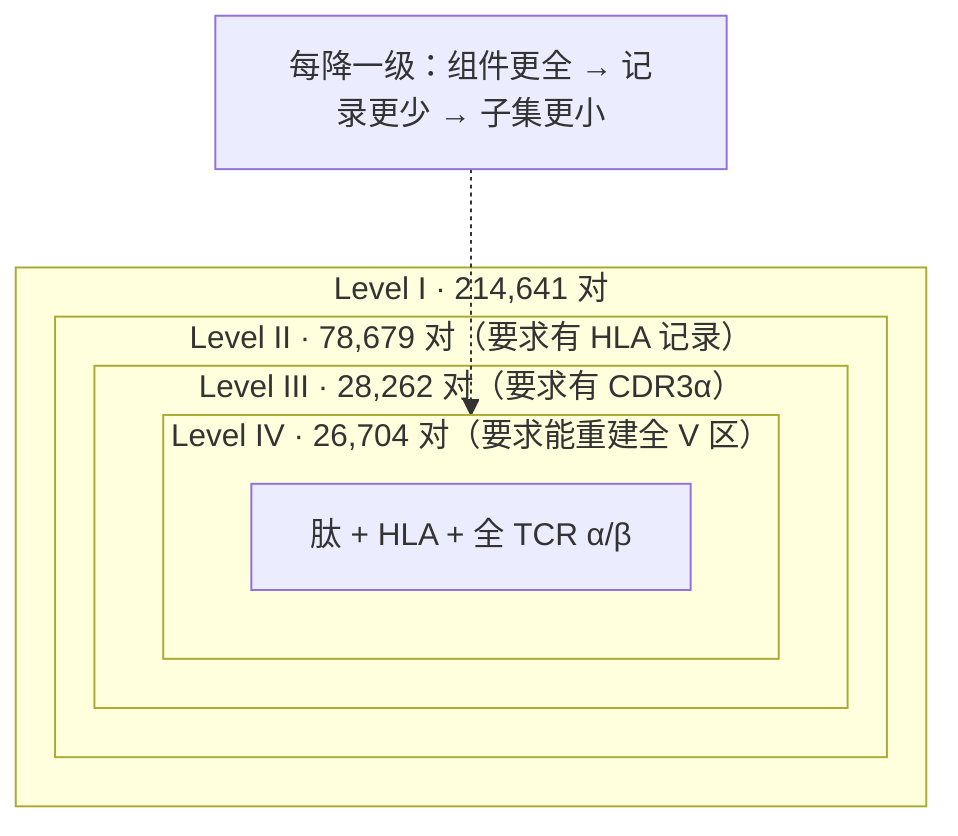
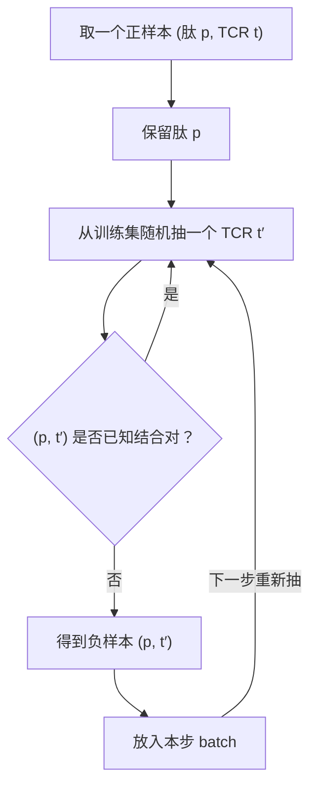

# Hi-TPH 精读：这个领域过去几年刷的可能不是"结合"，是"负样本"

> **阅读范围声明**：本次读了正刊全文 12 页（Introduction / Results / Discussion / Methods / Data & Code availability），以及正文中的 Table 1、Table 2 与 Fig. 1–4 的图注。
> **未读**：Supplementary Information（Supplementary Tables 1–17、Supplementary Figs. 1–10、Supplementary Algorithm 1）。本地只有正刊 PDF，没有 SI 文件。凡是依赖 SI 的结论，本文一律标注为「作者声称，SI 未读」，不替它背书。
> **本文中的计算**：第 8 节的"逐层增益网格"、第 5 节的负空间覆盖率，都是我用 Table 1/Table 2 的原始数字自己算的，已标明出处；它们不是论文里的数字。
> 所有配图均从原文 PDF 高分辨率裁切（`figs/`），未重绘。

---

## 0. 先认人

|       |                                                                                                                         |
| ----- | ----------------------------------------------------------------------------------------------------------------------- |
| 标题    | Machine learning dataset and benchmark for accurate T cell receptor–pHLA binding prediction                             |
| 期刊/类型 | **Nature Computational Science**，Resource（注意：是 Resource，不是 Article —— 这个类型本身就说明它的主要交付物是**数据集与基准**，不是新算法）                |
| 作者    | Xinyuan Zhu、Jiadong Lu（共同一作）、Yeqing Lu、Yuyan Zhang、**Fuli Feng**（通讯）                                                    |
| 单位    | 中国科学技术大学 信息科学与技术学院 / 人工智能与数据科学学院 / 网络空间安全学院；中关村学院                                                                       |
| 时间线   | 2025-08-03 收稿 → 2026-09-25 接收 → 2026-10-26 在线                                                                           |
| 交付物   | 数据集 Hi-TPH + 微调模型族 Hi-TPH-PLMs + 基准平台；GitHub `Jiadong001/Hi-TpH`、Zenodo `10.5281/zenodo.22647655`、**CC BY-NC 4.0（禁商用）** |

**它自己说的一句话主张**：TCR–pHLA 结合预测被"序列不完整"和"负样本有偏"两个数据问题卡住；我们造了一个四层级的、按需生成负样本的大数据集 Hi-TPH，在上面微调了一批蛋白质语言模型（PLM），在外部湿实验集 IMMREP2023 上比 SOTA 相对提升 19.2%；而且因为数据集是分层设计的，可以反过来解剖"每个分子组件各贡献了多少"。

---

## 1. 切入点：0.50 的秘密

先把这张表放在最前面。这是论文 Table 2 的**第一列**（level I，也就是"肽 + CDR3β"这个最常见的老配置），在外部基准 IMMREP2023 上的 AUROC：

| 工具 | AUROC |
|---|---:|
| UnifyImmun（2025, Nat. Mach. Intell.） | 0.5072 |
| DAISY（2025, Adv. Sci.） | 0.5194 |
| PanPep（2023, Nat. Mach. Intell.） | 0.5263 |
| TEIM（2023, Nat. Mach. Intell.） | 0.5588 |
| epiTCR（2023, Bioinformatics） | 0.5603 |
| ERGO-II（2021，level III/IV） | 0.5040 / 0.5048 |

**AUROC = 0.5 就是抛硬币。** 这批工具在自己的论文里普遍报的是 0.8–0.9 这个量级的天花板，可一挪到 IMMREP2023 上，四个就掉到了 0.50–0.53。作者的原话是"performance near the level of random chance"。

这就是整篇论文真正的起点，也是我读它时抓的那根脊柱：

> **同一个模型，为什么在自家测试集上是 0.9，在别人的测试集上就是 0.5？**

论文给出的答案不是"模型不够深"，而是**数据侧的两件事**：

1. **负样本是被冻结的**。绝大多数工具在训练前一次性造好一个固定的负集（fixed-random 或 fixed-frequency），然后整个训练过程反复看这同一批负样本。负空间有多大？用 Hi-TPH level I 的规模估：1,647 种肽 × 204,376 个 TCR ≈ **3.4×10⁸** 个可能的对；而正样本只有 214,641 个。一个 1:1 的固定负集，只覆盖了负空间的 **0.06%**。模型完全可以不学"什么叫不结合"，而是把这 21 万个具体配对**背下来**。换一个测试集，负样本的生成规则一变（IMMREP2023 用的是"同一 TCR × 别的肽"），背下来的东西全部失效 → 掉回 0.5。
2. **输入组件被砍掉了**。老数据集大多只有 CDR3β。可 TCR 认识 pHLA 靠的是整个 V 区，尤其 CDR1/CDR2 去搭 HLA 的 α 螺旋。只给 CDR3β，等于让人只看指尖去认脸。

所以这篇文章表面上在交付"数据集 + PLM"，实际打的那一枪是：**这个领域近年刷的指标，有很大一部分测的是"你对某个特定负分布拟合得多好"，不是"你懂不懂结合"**。后面每一节我都会回到这句话。

顺带一个容易被忽略的细节：**这张总览图自己已经承认了这件事。** 请看 Fig. 1c 最下面那个 `(3) Contribution of different components` 小格——CDR3α、TCRα、TCRβ 旁边都打了勾，**唯独 HLA 那个框没有勾**。作者在图里就留了这个伏笔，直到 Fig. 4f 才解释为什么。

![[figs/fig1_dataset_overview.png]]
*这张图想让你看清的是：数据集怎么造（a）、怎么切分（b）、以及基准要回答三个问题（c）。但请顺手注意两件事：(i) 右边 b 栏把"长尾肽"单独抽出来做 unseen set；(ii) c 栏 (3) 里 HLA 没有打勾。*

---

## 2. 概念词典（先定义，再判定）

> 这一节是硬的：后面第 7 节的承重判定、第 8 节的增益算术，每一个术语都在这里先落地。看不懂缩写墙的那种精读，是在浪费你的时间。

### 2.1 生物学侧

| 术语                     | 一句话是什么                                                                          | 解决什么问题 / 为什么要它                                                     | 类比                            |
| ---------------------- | ------------------------------------------------------------------------------- | ------------------------------------------------------------------ | ----------------------------- |
| **TCR**（T 细胞受体）        | T 细胞表面的受体，负责"尝"出对方呈递的抗原片段                                                       | 免疫系统识别感染/肿瘤的第一道分子关卡                                                | 门锁的钥匙胚                        |
| **α 链 / β 链**          | TCR 由一条 α 和一条 β 链配对组成（异二聚体）                                                     | 两条链**共同**决定特异性，单看一条会丢信息                                            | 一把钥匙的两半齿                      |
| **可变区（V region）**      | 每条链靠外的部分，个体间差异大，负责接触抗原                                                          | 特异性就藏在这里；恒定区（C 区）对区分结合/不结合没意义                                      | 钥匙的齿部 vs 钥匙柄                  |
| **CDR1 / CDR2 / CDR3** | 可变区上的三个"高变环"。CDR1、CDR2 由 V 基因编码，**主要搭 HLA 的 α 螺旋**；CDR3 由 V-(D)-J 重排产生，**主要搭肽** | 决定"看哪个 HLA"和"看哪段肽"的分工                                              | 手掌（CDR1/2 托住底座）vs 指尖（CDR3 摸肽） |
| **CDR3α / CDR3β**      | α 链和 β 链各自的 CDR3                                                                | 老数据集几乎只给 CDR3β，本文证明丢掉 CDR3α 会掉 ~18%                                | 少了一只手                         |
| **V(D)J 基因 / IMGT**    | TCR 由 V、D、J 基因片段重组而成；IMGT 是国际免疫遗传学数据库，提供标准胚系（germline）序列                        | 很多数据只记录"用了哪个 V 基因"，没记完整序列。本文用 IMGT 参考序列 + 实验测到的 CDR3，把 V/J 拼回完整可变区 | 只有零件编号，去标准件库把整根轴拼出来           |
| **pHLA / pMHC**        | peptide–HLA 复合物：一段肽卡在 HLA 分子的槽里                                                 | TCR 实际识别的不是裸肽，是"肽 + 呈递它的 HLA"这个整体                                  | 菜（肽）装在盘子（HLA）里才上桌             |
| **HLA class I**        | 几乎所有有核细胞都表达的一类呈递分子，把胞内肽（8–15 aa，常见 9 aa）呈给 CD8⁺ T 细胞                            | 本文**只做 class I**；class II（CD4⁺）明确留给未来工作                            | 本文只研究一种盘子                     |
| **表位（epitope）**        | 被 TCR 识别的那段具体肽                                                                  | 疫苗/细胞治疗的核心靶点                                                       | 菜里那一口的味道                      |
| **结合对 / 非结合对**         | 正样本 = 实验证实能结合；负样本 = 假定不结合                                                       | **关键陷阱**：负样本绝大多数**没做过实验**，是"配出来的"                                  | 相亲成功 vs "没试过所以默认不合适"          |

最后一行是全篇的地基。请记住：**"不结合"这个标签本身是构造出来的，不是测出来的**——这正是负采样策略能左右结论的原因。

### 2.2 机器学习侧

| 术语 | 一句话是什么 | 解决什么问题 | 类比 |
|---|---|---|---|
| **PLM**（蛋白质语言模型） | 在海量蛋白序列上用"遮词填空"自监督预训练的 Transformer，输出每位的上下文向量 | 把进化信息压进表示，下游只需小改 | 读过整个图书馆的人 |
| **ESM2 / ESMC / ProtBERT / TAPE-BERT / AMPLIFY** | 本文用的一批 PLM 骨干。ESM2 从 8M 到 650M；AMPLIFY 用到 SwiGLU / RMSNorm / FlashAttention | 本文要测"换骨干、加规模有没有用" | 不同出版社的同一套百科全书 |
| **微调（fine-tuning）** | 预训练权重 + 一个任务头，一起用任务数据继续训练 | 把"通用序列理解"转到"结合/不结合" | 通才转专科 |
| **`<cls>` token** | 序列最前面加的特殊符号，它的输出向量被当作整条序列的摘要 | 一条变长序列 → 一个定长向量，才能接分类器 | 读完一段话后写的一句摘要 |
| **RoPE**（旋转位置编码） | 用旋转矩阵把位置信息注入注意力 | 让模型知道"谁在前谁在后" | 给每个字编号 |
| **MLP 分类头** | 480 → 256 → 64 → 2 的全连接小网络 | 把摘要向量映射成"结合/不结合"两个 logit | 最后拍板的那一层 |
| **AUROC** | 随机取一个正样本和一个负样本，模型给正样本打分更高的概率 | 阈值无关的排序质量；**0.5 = 瞎猜** | 两个人排队，你排对的概率 |
| **AUPRC** | 精度-召回曲线下面积 | **类别不平衡时比 AUROC 敏感**；IMMREP2023 是不平衡的 | 更在乎"报出来的准不准" |
| **fixed-random 负采样** | 训练前把肽和 TCR 做笛卡尔组合、剔除已知正对，**冻结**这个负集 | 简单，但模型会背 | 一本固定的错题本 |
| **fixed-frequency 负采样** | 按肽在正样本里出现的频率来抽肽，再配随机 TCR，**冻结** | 让负集的肽分布对齐正集 | 按题型比例出的错题本 |
| **on-the-fly 负采样** | **每个训练步**重新生成负样本：留下正对的肽，换一个随机 TCR，撞上已知正对就重抽 | 负样本永不重复，模型无法背 | 每次考试重新出题 |
| **long-tail 肽 / unseen set** | 出现次数 < 50 的肽算长尾；抽 100 个长尾肽、把它们的所有样本**全部**留出，构成 unseen set | 专门测"没见过的肽"能不能泛化 | 期末考出没讲过的新题 |
| **集成（ensemble）** | 9 个模型的打分等权平均 | 降方差 | 九个医生会诊 |
| **IMMREP2023 / IMMREP2025** | 免疫信息学界的 TCR-表位预测盲测竞赛。2023 版是本文的主外部基准；2025 版更难（同一 TCR 配同 HLA 下的其他肽，且肽刻意远离已知表位） | 提供"别人家的、湿实验标注的"测试集 | 统一考卷 |

---

## 3. 研究路径重建：作者看到了什么，押了什么注

把论文读成"方法章节的顺序"会读错。真实路径大概是这样：

**① 先看到了一个不舒服的事实。** 一批发在 Nat. Mach. Intell. / Adv. Sci. 上的工具，在 IMMREP2023 上 AUC 接近 0.5。这不是"模型不够强"，因为其中有些模型比本文用的 PLM 还大、还复杂。**共同点只有一个：它们都在固定的负集上训练。**

**② 于是把赌注押在"数据"而不是"模型"上。** 这个赌注有一个非常干净的验证方式，而且作者真的做了：**把已有的工具原样搬到 Hi-TPH 上重训**——如果它们也涨，说明涨的是数据，不是 PLM。论文把这件事放在 Supplementary Table 3（我未读 SI，只能引作者的说法："retraining established tools on Hi-TPH also gains relative performance improvement"）。同时还有反向对照：**同一个 PLM，换到旧数据集上训，就掉下去**（Supplementary Table 2，同样 SI 未读）。

这两个方向一起才构成"数据承重"的论证。**这是我判断这篇论文可信度的关键点，也是它最容易被读者跳过的地方**——因为两个表都在 SI 里。

**③ 为了让"数据为什么有用"可解释，把数据集做成分层。** 四层不是随手分的，是一个"由数据构造出来的消融实验"：每加一类组件，就能测它的边际贡献。

**④ 最后一层押注，也是最漂亮的一层：组件之间不是相加，是相乘。** HLA 的贡献取决于你有没有给全 TCR 链。这个发现不是设计出来的，是第 ③ 步的分层数据"掉出来"的。

> 值得点出的一处方法论自觉：作者在 Discussion 里说"a critical shift from pursuing pure algorithmic complexity to leveraging the synergy between high-quality data and foundational PLMs"。这句话是全文的自我定位——**它承认自己不是算法论文。**

---

## 4. 数据集的架构（一）：四层不是"加法"，是"嵌套缩小"

这是我认为读这篇论文时**最容易读错的一张图**。

Fig. 1a 看起来像"level I 加 HLA 变 level II，再加 CDR3α 变 level III，再加全链变 level IV"——一个干净的加法阶梯。**但样本量告诉你的不是这个。**

| 层级 | 组件 | 正样本对数 | 独特肽数 | 独特 TCR 数 |
|---|---|---:|---:|---:|
| Level I | 肽 + CDR3β | **214,641** | 1,647 | 204,376 |
| Level II | + HLA | 78,679 | 1,401 | 73,553 |
| Level III | + CDR3α | 28,262 | 1,148 | 26,353 |
| Level IV | + 全 TCR α/β 链 | **26,704** | 927 | 24,639 |

**四层是嵌套子集，不是同一批数据加列。** 从 level I 到 level IV，样本量掉了 **8 倍**（214,641 → 26,704）。原因是"要求更多组件"等价于"要求这条记录在原始数据库里更完整"，而记录越完整越稀有。

这带来一个必须说清楚的**混淆**：

> 当你在 Fig. 4a 里看到"level 越高，unseen 集上掉得越少"，你无法把功劳唯一地归给"组件更全"——因为**同时**发生了"训练样本少了 8 倍"。样本量变少本来应该让泛化变差，所以观察到的改善更有可能是组件的功劳；但这仍然是**两个变量一起动**，不是受控实验。

**真正干净的消融在 Fig. 4e/f：他们固定在 level IV 内部，只改输入组件。** 这是全文实验设计最严谨的地方，第 7 节主要靠它。

### 数据是怎么拼出来的（Fig. 2）

![[figs/fig2_construction_pipeline.png]]
*这张图想让你看清的是：数据不是"下载来的"，是**重建**出来的。a 是总管线，b 是把 V(D)J 基因注释拼回完整可变区的具体步骤，c 是对比规模（注意横轴是对数）。*

三点值得单独说：

1. **V(D)J 重建（Fig. 2b）是这篇论文一个被低估的贡献。** 大多数数据库只记"这个 TCR 用了 TRAV12-1 和 TRAJ33"，不记完整核苷酸/氨基酸序列。作者拿 IMGT 的标准胚系序列，在保守的重组信号motif处截断 V 和 J，再和实验测到的 CDR3 拼接，重建出完整 V 区。相比现成工具 Stitchr，他们**故意不重建恒定区（C 区）**——因为 C 区对所有 TCR 都一样，对判别结合/不结合没有任何信息量。这个"删掉无用部分"的决定，直接让 level IV 从"不存在"变成"2.6 万对"。
2. **规模对比要看对数轴。** Fig. 2c 的横轴是 $10^2$–$10^5$。level I 的 214,641 对是上一名 UnifyImmun（137,400）的 1.56 倍——听着不多；但 level IV 的 26,704 对是 STAPLER（4,457）的 **5.99 倍**，独特 TCR 是 **5.79 倍**。**"6 倍扩张"这个卖点只存在于 level IV**，这也是全文标题数字里唯一真正惊艳的一个。
3. **"大"的来源要说清。** 正样本来自 IEDB、VDJdb、McPAS-TCR、ImmuneCODE，**加上** PanPep、pMTnet、TEIM、epiTCR、STAPLER 这些工具论文自带的数据集。也就是说，Hi-TPH 在相当程度上是"过去几年所有工具训练集的并集"。这不影响它在 IMMREP2023 上的有效性（重叠已剔除），但它意味着 **"6 倍"里有多少是"新数据"、多少是"把散落的旧数据合起来"，论文没有拆开**。

---

## 5. 数据集的架构（二）：负样本才是主角

如果只能带走一个技术点，带走这一节。

### 三种负采样策略的差别

| | fixed-random | fixed-frequency | **on-the-fly** |
|---|---|---|---|
| 什么时候生成 | 训练前，一次 | 训练前，一次 | **每个训练步** |
| 怎么配 | 肽 × TCR 笛卡尔组合，剔除已知正对 | 按肽在正集中的频率抽肽，配随机 TCR | 保留正对的肽，换随机 TCR，撞正对就重抽 |
| 整个训练看到多少种负样本 | ≤ 21 万（固定） | ≤ 21 万（固定） | 21 万 × epoch 数 |
| 模型能不能背下来 | **能** | **能** | 不能 |

### on-the-fly 的算法（据 Methods 文字重画，非论文原图）

注意两个设计细节，它们不是随手写的：

- **保留肽、只换 TCR**。这保证负样本的肽分布和正样本一致（每个肽的负样本数与它的正样本数相同）。如果反过来换肽、固定 TCR，就会让"某些肽只以负样本出现"，模型会学出"这个肽=负"的捷径。
- **撞上已知正对就重抽**。没有这一步，负集里会混进假阴性，模型被教着把真结合判成不结合。

### 为什么它有效——一个数字化的解释

用 level I 的规模算（**这是我的算术，不是论文数字**）：负空间 ≈ $1,647 \times 204{,}376 \approx 3.4\times10^{8}$。

- 固定负集：214,641 / 3.4×10⁸ ≈ **0.06%** 的负空间，而且**每一轮都是这 0.06%**。
- on-the-fly 跑 30 个 epoch：214,641 × 30 ≈ 6.4×10⁶ 次抽样 ≈ **1.9%**，而且**基本不重复**。

32 倍的覆盖差异还不是关键。关键是**重复性**：固定负集训练 30 轮，模型对这 21 万个负样本看了 30 遍，它可以把它们当作一张查找表。on-the-fly 每次都换，模型的训练损失无法靠记忆下降，只能靠学一个更平滑的决策边界。作者的说法是"compelling the model to learn a more robust decision boundary"，翻成人话就是：**逼它学概念，而不是背答案。**

### 效果

Fig. 4c/d 里，on-the-fly（绿）在**所有** 6 个格子（2 个模型 × 3 个测试集）里都不低于两种固定策略。最硬的数字在 IMMREP2023、level IV：相对 AUROC 提升 **+5.22%（ESM2-35M）** 和 **+4.80%（ESM2-150M）**。

![[figs/fig4_benchmark_results.png]]
*这张图想让你看清四件事：a/b 是"没见过的肽"掉多少；c/d 是负采样策略的胜负；e 是组件逐个加上去；f 是 HLA 的双面性。请注意 c/d 里绿柱几乎全面压过橙柱和蓝柱，以及 e 里那根蓝色的"全 TCR"柱子。*

**这里必须留一个诚实的空档**：on-the-fly 和固定负集的差别是"**负样本更多样**"，不是"**负样本更多**"——两者负样本数量其实一样（都是 1:1）。但论文**没有做**"把固定负集按 epoch 重复喂 30 遍以对齐总曝光量"这种对照，也就没有直接把"多样性"和"曝光量"分开。它用来支撑机制的是 Supplementary Table 4（跨 epoch 的肽/TCR 覆盖扩张），**SI 未读**。所以"on-the-fly 有效是因为多样而不是因为多"这句话，在这篇文章里是**有机制解释、但没有干净的因果分离**。

---

## 6. 模型架构走读

![[figs/fig3_model_architecture.png]]
*这张图想让你看清的是：整个"模型"简单到近乎寒酸——一条拼起来的序列，过一个预训练 PLM，取 `<cls>` 向量，过一个三层小 MLP，出两个数。*

### 6.1 逐层走读

| 步骤 | 张量形状 | 在做什么 |
|---|---|---|
| ① 拼序列 | 长度 $L$ | 把 TCR 序列和 pHLA 序列（**肽直接接在 HLA 后面**）连成**一条**字符串 |
| ② 补特殊符 | $L+2$ | 头部加 `<cls>`，尾部加 `<eos>`；各组件先 padding 到固定长度（填充符 `X`） |
| ③ 过 PLM | $(L+2)\times d$ | 12 层 Transformer（示例为 ESM2-35M，$d=480$），带 RoPE 位置编码 |
| ④ 取摘要 | $d$ | 只取 `<cls>` 位置的上下文向量 |
| ⑤ 分类头 | $480\to256\to64\to2$ | 两层隐层 + ReLU，输出"结合/不结合"两个 logit |
| ⑥ 损失 | 标量 | 交叉熵；backbone 与 head **联合**优化 |

超参：Adam；学习率从 $\{10^{-4}, 8\times10^{-5}, 5\times10^{-5}, 3\times10^{-5}, 10^{-5}\}$ 里按**验证集 AUROC** 选；早停 patience=4；4×RTX 3090；batch 32（大模型降到 8 或 2）。

### 6.2 一个关键设计选择：为什么是"拼接"，而不是"分别编码再拼向量"

这是全文唯一真正属于"架构"的判断，值得展开。

另一条路线（如 TCR-ESM）是：TCR 过一遍 PLM，pHLA 过一遍 PLM，各得一个向量，再拼起来喂分类器。本文反其道——**先拼成一条序列，再一起过 PLM**。

区别在哪？Transformer 的注意力是**逐 token 全连接**的。拼成一条序列后，TCR 的每一个残基**可以直接 attend 到** 肽的每一个残基和 HLA 的每一个残基；注意力矩阵里自然长出"哪段 TCR 对着哪段肽"的交叉项。而分别编码再拼向量，两个模态在进入分类器之前**从未互相看过**——所有交互只能靠最后一层 MLP 去拟合，而那层只有 256 维。

作者用 Supplementary Table 8 / Fig. 7 支撑这个选择（SI 未读）。但从机制上它还有一个更漂亮的含义：

> **架构和结论在这里是自洽的。** 第 7 节会说"组件之间是协同的、相乘的"。**拼接式输入正是允许协同发生的唯一结构**——如果分别编码，你就结构性地禁止了"CDR1/CDR2 与 HLA 相互作用"这件事被学到。换句话说，Fig. 4f 那个"给了全 TCR 链之后 HLA 才开始有用"的发现，在分别编码的架构里根本不可能出现。

### 6.3 反过来的问题：为什么分类头这么浅？

因为**深的部分（12 层 Transformer）已经在预训练里学完了**，微调时只需要一个线性可分的读出层。这也解释了为什么换 PLM 家族、加大参数量都涨不动（见第 7 节）——**这个任务的信息瓶颈不在"表示能力"，在"数据里有没有那条信息"**。

---

## 7. 承重判定：拆掉哪个会塌

| 设计 | 判定 | 证据 | 白话：它为什么存在 / 拔掉会怎样 |
|---|---|---|---|
| **Hi-TPH 的规模与组件完整度** | **承重** | 反向：同一 PLM 换旧数据集就掉（Supp. Table 2）；正向：老工具搬到 Hi-TPH 重训就涨（Supp. Table 3）。**两表均在 SI，未读** | 决定模型"有没有机会看到"信息。数据里没有 CDR1/CDR2，再大的模型也变不出来 |
| **全 TCR α/β 链（vs 只有 CDR3）** | **承重**（幅度最大） | Fig. 4e：level IV 内部，从"肽+HLA+CDR3β"到"+全 TCR"，AUROC 0.5656→0.7574（**+33.9%**） | CDR1/CDR2 才是搭 HLA 的地方。只给 CDR3 = 只给指尖 |
| **CDR3α** | 贡献 | Fig. 4e：0.5656→0.6686（**+18.2%**），ESM2-150M 为 +18.5% | α 链的 CDR3 携带独立于 β 链的信息，不是冗余 |
| **HLA 序列** | **条件性**（不是"承重"也不是"装饰"） | Fig. 4f 左（肽+CDR3β）：0.5734→**0.5656**（−1.36%）、0.5804→**0.5685**（−2.05%）；右（肽+全 TCR）：0.7379→**0.7574**（+2.64%）、0.7287→**0.7399**（+1.54%） | **没有 V 区上下文时，HLA 是噪声而不是信号**。模型没有能"对接"HLA 的那部分输入，于是 HLA 只贡献了混淆 |
| **on-the-fly 负采样** | **承重**（概念核心） | Fig. 4c/d 全面胜出；IMMREP2023 level IV 上 +5.22% / +4.80%。**注意：没有"对齐曝光量"的数据量对照**，多样性 vs 曝光量未分离 | 决定模型学"概念"还是背"查找表"。这是把 0.5 拉回 0.7 的那一手 |
| **PLM 骨干的选择与规模** | **装饰**（对精度而言） | Table 2：ESM2-8M 在 level I 是 0.6567，**高于** 650M 的 0.6235；level IV 上 8M=0.7404 vs 650M=0.7655，差 0.025。作者自承"scales with model size only when the input data are sufficiently complex" | 架构是商品（commodity）。这条是论文最诚实、也最反"堆模型"直觉的一处 |
| **集成（9 模型等权平均）** | 贡献（但成本×9） | Table 2：level IV 集成 0.7979 vs 平均 0.7494 vs 最佳单模 0.7655 | 降方差。**注意：level I 上集成 0.6508 反而低于单模 ESM2-8M 的 0.6567**，集成不是万灵药 |
| **三维结构** | 未使用（刻意的缺席） | 全文纯序列 | 这是路线的边界而非疏忽。但 IMMREP2025 的教训（见第 9 节）暗示结构可能真的有用 |

**关于 HLA 那一行，值得多说两句**，因为它是我读这篇论文时最有收获的地方：

"加一个特征会不会变好"这个问题本身是**错的**。正确的问法是"**在已有特征的条件下**，加它会不会变好"。HLA 只有在模型同时拥有 CDR1/CDR2（即全 V 区）时才有正贡献——因为生物上就是 CDR1/CDR2 去接触 HLA 的 α 螺旋，CDR3 主要接触肽。**如果你只给 CDR3，模型手里没有"能接 HLA 的那只手"，HLA 就退化成一根没处插的线。**

把 Fig. 4f 的四个数字并排看就更清楚了（左边"没有那只手"，右边"有那只手"）：

| 输入组合 | ESM2-35M | ESM2-150M |
|---|---|---|
| 肽 + CDR3β（无 HLA） | 0.5734 | 0.5804 |
| 肽 + CDR3β **+ HLA** | **0.5656（↓1.36%）** | **0.5685（↓2.05%）** |
| 肽 + 全 TCR（无 HLA） | 0.7379 | 0.7287 |
| 肽 + 全 TCR **+ HLA** | **0.7574（↑2.64%）** | **0.7399（↑1.54%）** |

同一个 HLA 序列，在两种上下文里符号相反。**这不是"HLA 有时有用有时没用"，而是"HLA 的作用必须由一个能读懂它的伙伴来解释"。**

这条结论有独立的交叉验证：作者做了注意力图分析（Supplementary Fig. 5，SI 未读），显示注意力分布呈现"组件感知"的模式，和上述贡献一致。**注意这是"一致"而非"证明"**——注意力权重高不等于因果重要，这是可解释性研究的老问题。

---

## 8. 公式落地：+19.2% 是从哪个格子里算出来的

系统的公式只有两个，都很朴素，但第二个是全文争议的焦点。

### 8.1 集成打分

对第 $\ell$ 层的输入对 $x$，$M_\ell$ 个模型等权平均：

$$f^{(\ell)}_{\text{Ens}}(x)=\frac{1}{M_\ell}\sum_{m=1}^{M_\ell} f^{(\ell)}_m(x)$$

**具体算一遍**（level IV，$M=9$）：假设 9 个模型对同一对打分为 0.91, 0.88, 0.85, 0.83, 0.80, 0.78, 0.76, 0.74, 0.72，则

$$f_{\text{Ens}}=\frac{0.91+0.88+0.85+0.83+0.80+0.78+0.76+0.74+0.72}{9}=\frac{7.27}{9}=0.8078$$

没有任何加权、没有在 IMMREP2023 上调过参数（作者明确说 "No model selection, weighting or hyperparameter tuning was performed on IMMREP2023"）——这一点很重要，否则外部基准就被污染了。

### 8.2 相对增益：+19.2% 的来历

$$\text{relative gain}=\frac{\text{AUROC}_{\text{ours}}-\text{AUROC}_{\text{best existing}}}{\text{AUROC}_{\text{best existing}}}$$

代进去（Table 2，**level III**）：

$$\frac{0.7163-0.6011}{0.6011}=\frac{0.1152}{0.6011}=0.1917\;\Rightarrow\;+19.2\%$$

对上了。**但请把同一个公式在另外三层各算一遍**——这是本文最该被追问的地方：

| 层级 | 最佳已有工具（AUROC） | Hi-TPH 集成 | 相对增益 | 最佳已有工具（AUPRC） | Hi-TPH 集成 | 相对增益 |
|---|---|---:|---:|---|---:|---:|
| Level I | epiTCR 0.5603 | 0.6508 | **+16.2%** | TEIM 0.2586 | 0.4072 | **+57.5%** |
| Level II | PISTE-unipep 0.5889 | 0.5918 | **+0.5%** | PISTE-unipep 0.2850 | 0.3925 | **+37.7%** |
| Level III | EPACT 0.6011 | 0.7163 | **+19.2%** ← 标题数字 | EPACT 0.3383 | 0.4745 | **+40.3%** |
| Level IV | EPACT 0.7500 | 0.7979 | **+6.4%** | STAPLER 0.5405 | 0.5800 | **+7.3%** |

*(本表全部由 Table 2 原始数字计算，论文没有给出这张表。)*

看清楚了吗：**"19.2%" 是 8 个格子里最漂亮的那一格。** 同一批模型，在 level II 上相对 AUROC 只领先 **0.5%**（0.5918 vs 0.5889）——这个差距在实际意义上就是平局（论文没有给 IMMREP2023 上的置信区间，所以也无法谈显著性）；在 level IV 上领先 6.4%；而 AUPRC 那一列又完全不同（level II 上 +37.7%）。

正文其实写清楚了"on level III"，**摘要没写**。所以这不是数据造假，是**框架选择**——挑了对它最有利的那一层来当标题。而 level III 恰好是"已有工具最弱"的层级（EPACT 只有 0.6011），因为那一层的输入配置（肽+HLA+双 CDR3）本来就不是各家工具的主场。**在 level IV（组件最全、和 STAPLER/EPACT 真正同场竞技的那一层），优势收缩到个位数。**

---

## 9. 证据边界：哪些结论站得住，哪些还没建立

### 站得住的

1. **负采样策略确实影响很大，且 on-the-fly 优于两种固定策略。** c/d 两个面板 × 三个测试集全胜，方向一致、幅度可达 +5%。**但"多样 vs 曝光量"没有被分离**（见第 5 节末），所以更准确的说法是"负样本**分布**很重要"，而不是"on-the-fly 这个具体实现是唯一解"。
2. **组件贡献不是可加的。** Fig. 4e/f 是 level IV 内部的受控比较（同一批正样本、同一负采样策略，只换输入），这个设计是对的。HLA 的双面性有明确的两组数字支撑。
3. **在 IMMREP2023 上，这套模型确实进入了第一梯队。** 重叠已剔除（Supp. Table 13/14，SI 未读但方法描述合理）；集成完全没有在测试集上调参。

### 没建立 / 被夸大的

1. **"19.2%" 是四层里最好的一层。** 见第 8 节。摘要省略了 "level III"。**读这篇论文时，如果你只记一个数，请记 level IV 的 +6.4%，而不是 19.2%。**
2. **平均模型其实没赢。** Table 2 里 `Hi-TPH-PLMs-Avg.` 在 level IV 是 **0.7494**，低于 EPACT 的 **0.7500**——**九个微调 PLM 的平均水平，打不过一个 2025 年的专用工具**。赢的是那个 9 模型集成（0.7979）。而集成的成本是 9 倍推理。论文用"集成"当门面，用"平均"当脚注，读者容易混。
3. **"external wet-lab test set" 这个说法会被误读。** IMMREP2023 的标签确实来自湿实验（各家实验室提交的实测数据），但**本文作者没有做任何新的湿实验**。这是"用别人测好的标签"，不是"我们测了"。摘要的措辞容易让人以为作者做了验证实验。
4. **层与层之间不可比。** 每一层的"最佳已有工具"是**不同的工具**（level I 是 epiTCR，level II 是 PISTE，level III/IV 是 EPACT）。所以"逐层击败 SOTA"这句话里，"SOTA"一直在换人。真正的同场竞技只发生在 level IV。
5. **"6 倍扩张"有多少是新数据？** Hi-TPH 的正样本 = IEDB/VDJdb/McPAS/ImmuneCODE + PanPep/pMTnet/TEIM/epiTCR/STAPLER 各自的数据集。它是**并集**。这本身有价值（统一清洗、重构 V 区、消除冲突），但"6 倍"不等于"6 倍新知识"。论文没有拆解这部分。
6. **AUROC 与 AUPRC 在 level II 上严重分歧**（+0.5% vs +37.7%）。这说明"有没有提升"取决于你问哪个指标。在不平衡的 IMMREP2023 上，AUPRC 通常更该被信任；但论文的标题用的是 AUROC。**两个指标给出两个故事时，正确做法是两个都报——他们报了（Table 2 两列都在），但叙事只用了对自己有利的那个。**

### 作者自己承认的最重要一条（这条最有分量）

> "We also evaluated existing tools and Hi-TPH-PLMs on the recently released **IMMREP2025** benchmark... IMMREP2025 designs a more challenging setting: for each positive TCR–pHLA pair, negative samples are generated by pairing **the same TCR with alternative peptides within the same HLA**, and the peptides are deliberately distant from published epitopes. These choices reduce peptide-side motif similarities available to sequence-based models, **leading to lower overall performance and smaller method differences compared with IMMREP2023**."（Discussion，Supplementary Table 17）

翻成人话：**换一个更严格的负样本协议，大家的表现都往下掉，而且差距缩小了。** 而在 IMMREP2025 的官方报告里，表现最好的是**用了结构建模**的方法。

这句话几乎是把第 1 节的论点又推了一层：如果优势会随着"负样本协议的严格程度"而收缩，那么**本文测到的优势里，仍有一部分来自"和某个负分布匹配得好"**，而不是纯粹的"懂结合"。**这不是论文的缺陷，这是整个领域的测量困境——而这篇论文是少数几个把这件事摆到台面上说的。**

顺带：这也直接给出了下一步的方向——**纯序列路线的天花板可能就在这儿，要再往上得接结构**（呼应作者自己说的"fine-grained peptide specificity prediction may benefit from integration with folding models and structure-based rescoring"）。

### 其它边界

7. **只做 HLA class I**，8–15 aa 肽，9–19 aa CDR3，全链 105–121 aa。class II / CD4⁺ 完全没覆盖。
8. **数据源偏差被继承**：模型偏好 9-mer 肽、15 残基 CDR3、常见 HLA 等位基因（Supp. Fig. 9/10、Table 7，SI 未读；作者自己承认）。
9. **只做二分类，不做亲和力。** 没有 $K_d$ / $\text{pIC50}$，所以**不能排序**——两个都判"结合"的候选，它无法告诉你哪个更好。这对实际筛选是硬限制。
10. **内部与外部指标不同质**：内部 test/unseen 是 1:1 采样、5 次重复取均值；IMMREP2023 用原生不平衡分布。所以表里的 0.75 和 0.80 不能直接跨列比较。
11. **"actively maintained" 是承诺，不是既成事实**——需要用一段时间才知道。

---

## 10. 读完带走的五句话

1. **这篇论文真正的主角是"负样本"，不是 PLM。** 它最硬的洞察是：这个领域过去测的很多是"你对某个固定负分布的拟合度"，一旦负样本协议变了（IMMREP2023 → 2025），优势就缩水。0.5 的那些工具不是笨，是在答另一道题。
2. **"加特征有没有用"是个错问题。** 正确的问法是"在已有特征下加它有没有用"。HLA 单独出现时是噪声（−1.4%~−2.1%），配上全 TCR 链才变成信号（+1.5%~+2.6%）。这条可以迁移到你做的任何多组件融合任务上。
3. **架构在这条线上是商品。** ESM2-8M 和 ESM2-650M 差不到 0.03，8M 在 level I 上还更强。作者自己承认规模只有在数据足够复杂时才起作用。**投资数据 > 投资模型**，这是 Resource 类论文的典型结论。
4. **拼接式输入不是实现细节，是世界观。** 只有把 TCR 和 pHLA 放在同一条序列里，逐 token 的注意力才可能长出跨分子交互——这才让"组件协同"这个发现在结构上成为可能。分别编码再拼向量，等于禁止了你要找的东西。
5. **标题数字要自己复算。** 19.2% 是 level III 的 AUROC 相对增益；同一批模型在 level II 是 +0.5%，level IV 是 +6.4%，AUPRC 一列又是另一个故事。**一个数字被选中当标题，本身就是一条信息。**

## 还开着的问题

- **如果把 on-the-fly 负采样装到 STAPLER / EPACT 上，它们能涨多少？** 这是判定"数据 vs 模型"最关键的实验，论文只在 SI 里给了"重训会涨"的定性说法（Supp. Table 3），没给逐工具的对照数字。
- **为什么 HLA 在缺少 V 区时会是负贡献？** 论文给的是"需要 CDR1/CDR2 作为上下文"的解释，但没有做"只给 CDR1/CDR2 而不给 CDR3"的反向实验来把这个解释钉死。这是一个可以直接做的 ablation。
- **IMMREP2025 上到底差多少？** 在 Supp. Table 17，未读。**如果你要拿这篇做汇报，这个数字值得单独去 SI 里挖出来**——它是整篇论文可信度的压力测试点。
- **结构信息能不能补上最后的差距？** 作者把"接结构重打分"当成未来工作，而 IMMREP2025 的结果暗示这不是可选项。
- **class II 什么时候做？** 现在完全空白，而 CD4⁺ 应答在肿瘤免疫里同样关键。

---

## 附：图表索引（均为原文裁切，200 dpi）

| 文件 | 原文位置 | 内容 |
|---|---|---|
| `figs/fig1_dataset_overview.png` | Fig. 1（第 2 页） | 数据集构造（a）、切分策略与长尾 unseen（b）、基准三大问题（c） |
| `figs/fig2_construction_pipeline.png` | Fig. 2（第 3 页） | 数据来源与清洗管线（a）、V(D)J 重建步骤（b）、规模对比对数轴（c） |
| `figs/fig3_model_architecture.png` | Fig. 3（第 5 页） | Hi-TPH-PLMs 架构：拼接序列 → PLM → `<cls>` → MLP |
| `figs/fig4_benchmark_results.png` | Fig. 4（第 7 页） | unseen 泛化（a,b）、负采样策略（c,d）、组件增量贡献（e）、HLA 条件性（f） |
